# Lab 1.1: Dendritic Spine Reconstruction

NEU466G, Dr. Kirk · [Class documents](index.md)
{ .class-doc-meta }

## Overview

Reconstruct 3 dendritic spines (including one branched spine) in adjacent images from serial electron micrograph sections. The dendritic shaft has already been traced for you (d03, yellow), and the spines you will trace have been marked with protrusion stamps (d03p##, red) that will guide you where to start tracing your assigned spines: **d03p06, d03p32, d03p47**. These protrusions can be found under the group labeled "Module_1."

## Tracing dendritic spines

### Find your p-stamps

- Go to **Lists > Object list**. You may need to resize your Object List to be able to see all the Columns displayed in the list. Be sure you click and drag so that you can see the Groups column.
    - One thing that will be helpful as you become familiar with PyReconstruct is the ability to Filter the Object List. To do this, select the Filter menu item in the Object List window and then Group filter. Next, select "Dend+Spines" to see only your assigned p-stamps for which you will fully trace their spines for Lab 1.1.

<figure class="class-fig" markdown="span">
  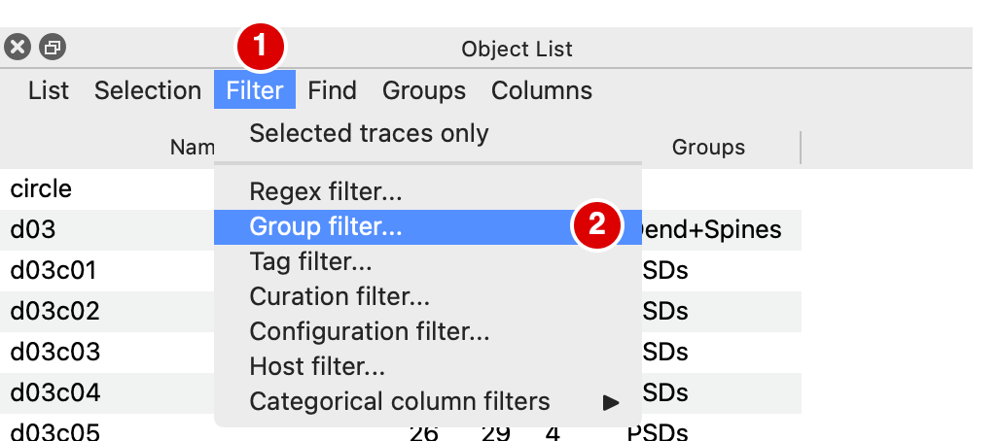{ width="514" }
  <figcaption>1: Filter. 2: Group filter...</figcaption>
</figure>

<figure class="class-fig" markdown="span">
  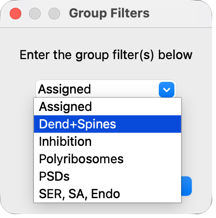{ width="223" }
  <figcaption>The Group Filters dialog.</figcaption>
</figure>

<figure class="clip" markdown>

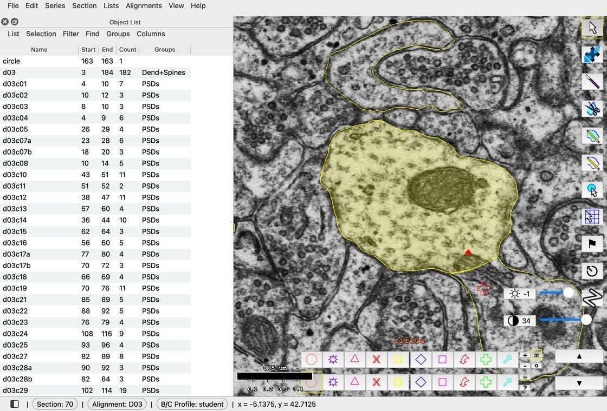

[▶ 6 s · loops](videos/lab-1-1/group-filter.mp4){ .clip-src }

<figcaption markdown>Filter > Group filter... > Dend+Spines > OK.</figcaption>
</figure>

- In the object list, double left-click on a p-stamp in the list.
    - This will take you to the first section that contains that p-stamp. This strategy becomes especially useful after you have traced several objects and you want to quickly find object(s) of interest.

<figure class="clip" markdown>

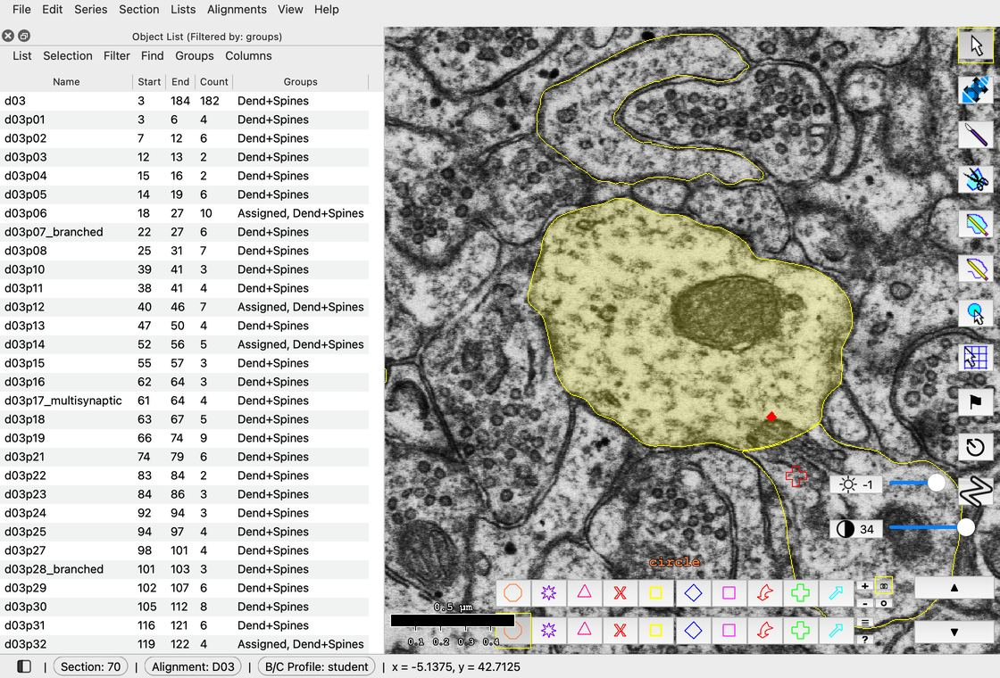

[▶ 5 s · loops](videos/lab-1-1/jump-to-stamp.mp4){ .clip-src }

<figcaption markdown>Double-click a p-stamp to go to the first section it is on.</figcaption>
</figure>

### Set up the trace palette

- Locate the trace palette (located at the bottom of the screen):

<figure class="class-fig" markdown="span">
  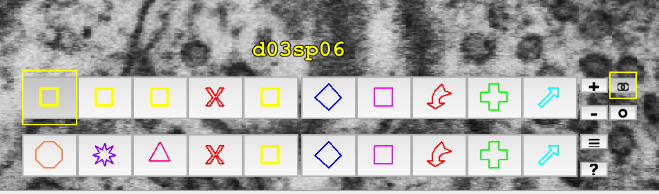{ width="477" }
  <figcaption>The trace palette.</figcaption>
</figure>

- In PyReconstruct you can right click on one of the trace palette buttons. A menu will appear that allows you to edit the Name, Color, and Fill style used for any **new** traces or stamps made while this palette entry is selected.

<figure class="class-fig" markdown="span">
  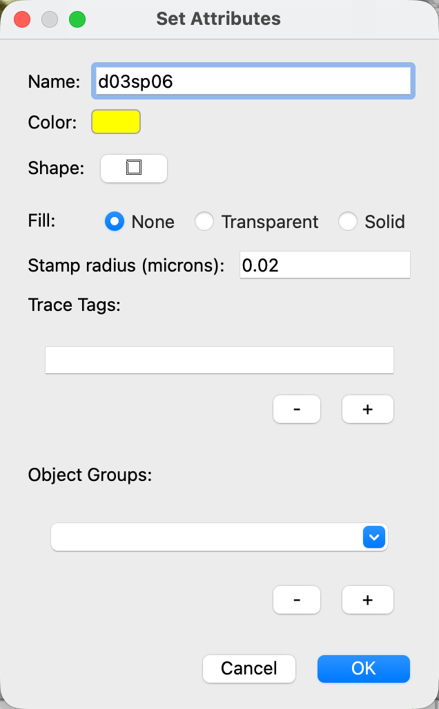{ width="318" }
  <figcaption>Set Attributes for d03sp06.</figcaption>
</figure>

- The attributes for your spine traces d03sp06, d03sp32, and d03sp47 have been set for you.

!!! warning
    Be sure when you switch to tracing a different spine that you also select the corresponding palette entry before you start tracing.

These are the spines you will fully trace for "Lab 1.1 - Dendritic Spines."

| Protrusion stamp name (p-stamp) | Spine trace name (d03sp##) |
| --- | --- |
| d03p06 | d03sp06 |
| d03p32 | d03sp32 |
| d03p47_branched | d03sp47 |

### Trace your dendritic spines

- To start, quickly jump to d03p06 by double clicking on it in the object list.
- Use the Closed Trace tool to create new traces: 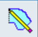{ .class-icon }
    - Clicking and dragging will create a trace by drawing (Scribble).
    - Single-clicking will create a polygon-style point-by-point trace (Poly).
    - To make your tracing easier, right click the Closed Trace icon in the tool palette and make sure your settings are set to the following:
        - Combo mode: will let you do both Scribble and Poly.
        - Make sure Closed Trace Shape is set to Trace since we are tracing spines that have a more irregular shape than the other two options.
        - Check "Automatically merge overlapping traces" and leave "Only merge selected traces" checked. This lets you quickly combine smaller overlapping component traces so you don't have to trace the entire boundary in one go. This is the same as selecting the traces you want to combine and merging them (Shift+M) but will be done automatically saving you keystrokes.
        - Apply rolling average while scribbling will smooth out the trace when you let go of left click. If you have a very sensitive mouse or sufficiently caffeinated, this will help keep your traces from ending up jagged.
        - 10-15 is a good setting to play around with to find what works best for you.

<figure class="class-fig" markdown="span">
  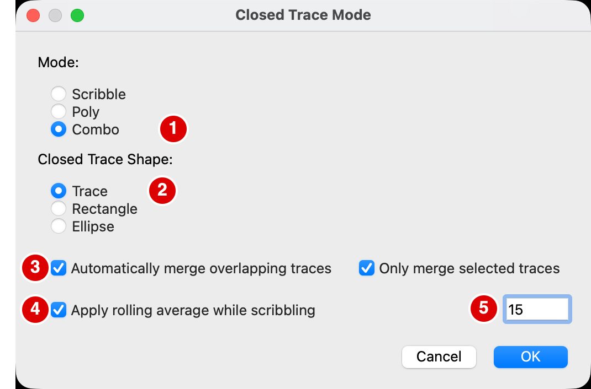{ width="535" }
  <figcaption>Closed Trace Mode settings.</figcaption>
</figure>

<figure class="clip" markdown>

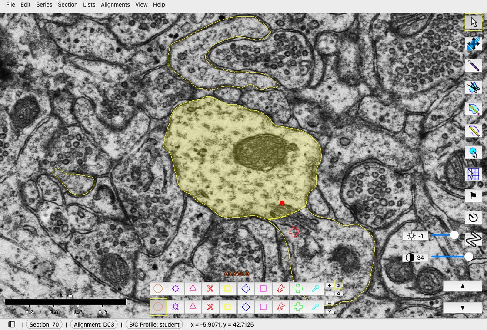

[▶ 7 s · loops](videos/lab-1-1/closed-trace-mode.mp4){ .clip-src }

<figcaption markdown>Right-click the Closed Trace tool, then set the settings in the order above.</figcaption>
</figure>

- To trace the spines, keep an eye out for areas of the dendrite where the membrane begins to protrude. These areas are marked by the protrusion stamp to help guide you.
- After you make your first spine trace, **you will notice that it does not immediately appear in your Object List.** This is because it has not been assigned to the Group that we filtered for back in Step 1. A handy way to see both the p-stamps and your newly created d03sp objects is to **open a second Object List.** Either click **Lists > Object list** in the main window or hit Ctrl+Shift+O. The second Object List opens as a new tab beside the first. To see both at once, drag its tab down until the lists sit one above the other. In the second Object List, let's now filter our list using Regex (regular expressions). To do this replace the .\* in the text field with "d03sp.\*" (no quotes) and click OK. This will filter the second Object List for anything that begins with "d03sp" followed by any other characters afterwards.

<figure class="class-fig" markdown="span">
  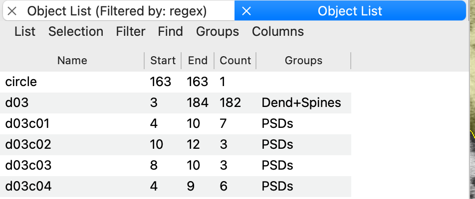{ width="476" }
  <figcaption>The second Object List opens as a tab.</figcaption>
</figure>

<figure class="class-fig" markdown="span">
  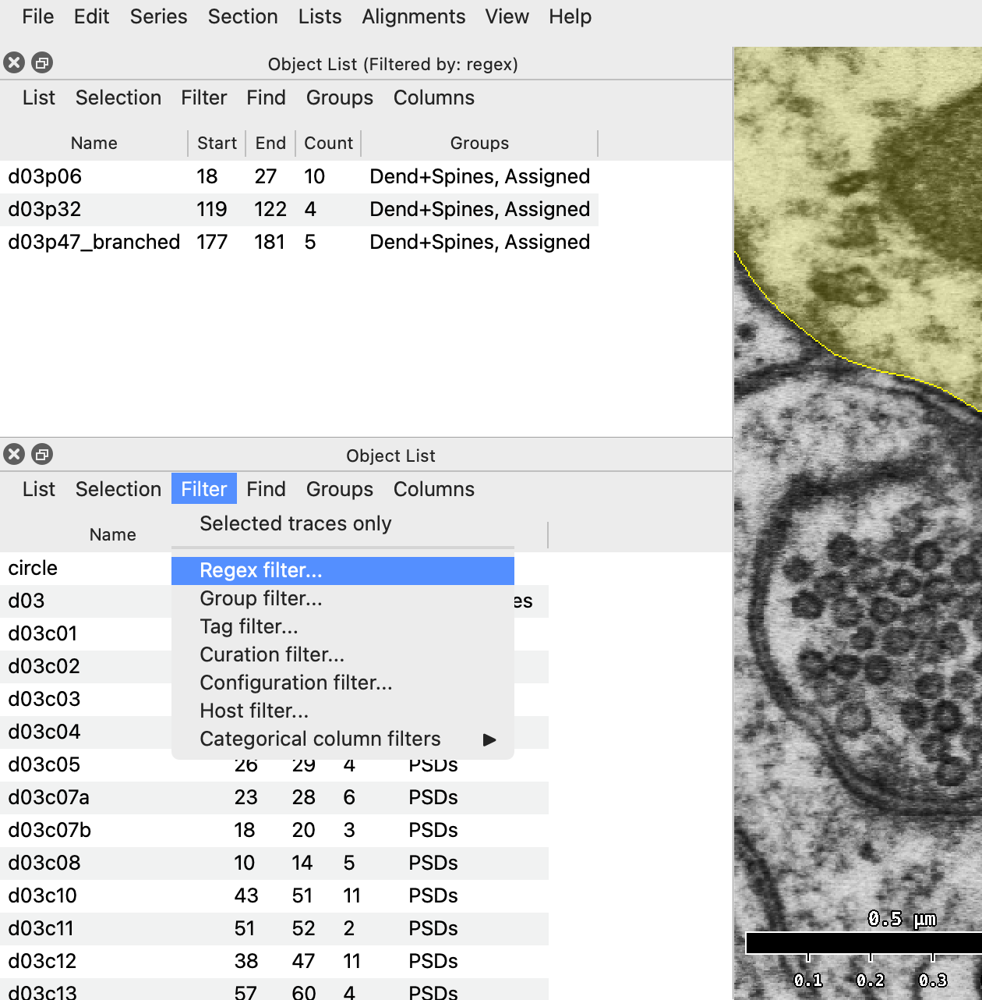{ width="630" }
  <figcaption>The two lists stacked, one above the other.</figcaption>
</figure>

<figure class="class-fig" markdown="span">
  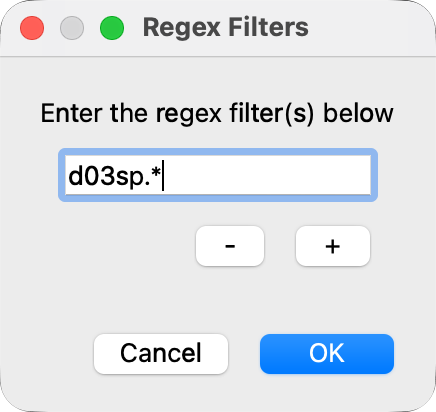{ width="218" }
  <figcaption>The Regex Filters dialog.</figcaption>
</figure>

- Scroll up and down through the sections to track the spine until you reach the spine head and synapse. Follow and trace the spine through to its completion before moving on to the next.

## 3D reconstruction

- Create and view a 3D rendering of your dendrite: Once you finish tracing your dendritic spines, reconstruct it in 3D by going to **Lists > Object list**. For your dendrite (d03) and each spine (d03sp##), right click > **3D > Add to scene**. A new 3D scene window should pop up. You can also select the object in the list (left click), then hold down the Shift key and double click the object name to add it to the scene.

## Saving and backups

- Be sure to save with "Ctrl+S" when finished!
    - If the program crashes and you have not saved, you will be able to restore any unsaved work the next time you open the series.

!!! warning "Attendance"
    At the end of every work session, create a backup of your .jser file. (You do not need to back up the image files, as they do not change.) **The .jser file MUST BE UPLOADED TO CANVAS TO GET CREDIT FOR CLASS ATTENDANCE.** To upload, go to Canvas: Assignments > Attendance.

Additionally, you can set up the auto-backup feature in PyReconstruct that will save a backup .jser file in a specified folder every time you save the series.

## Tips

Some useful tips to learn as you become more familiar with PyReconstruct:

!!! tip "Tip 1"
    Press / to flip back and forth between this section and the last one you viewed. Press the space bar to blend the two on screen, and press it again to stop.

!!! tip "Tip 2"
    To trim part of a trace, use the knife tool. Select the trace you want to trim first. The knife cuts traces of only one object at a time, so deselect traces of other objects.

!!! tip "Tip 3"
    You can access the Help menu for a list of keyboard shortcuts at any time by hitting the "?" key on your keyboard. The 3D scene window also has a separate Help window for specific keyboard shortcuts when manipulating the 3D scene.
