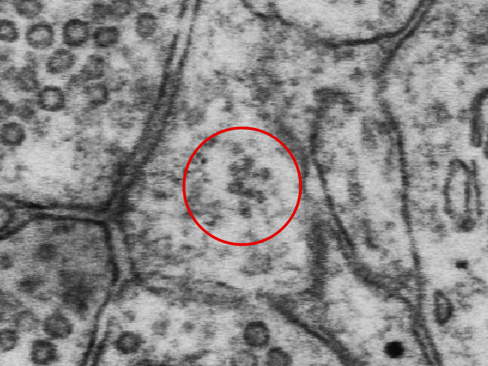
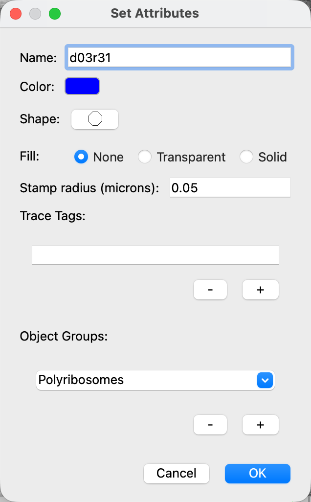
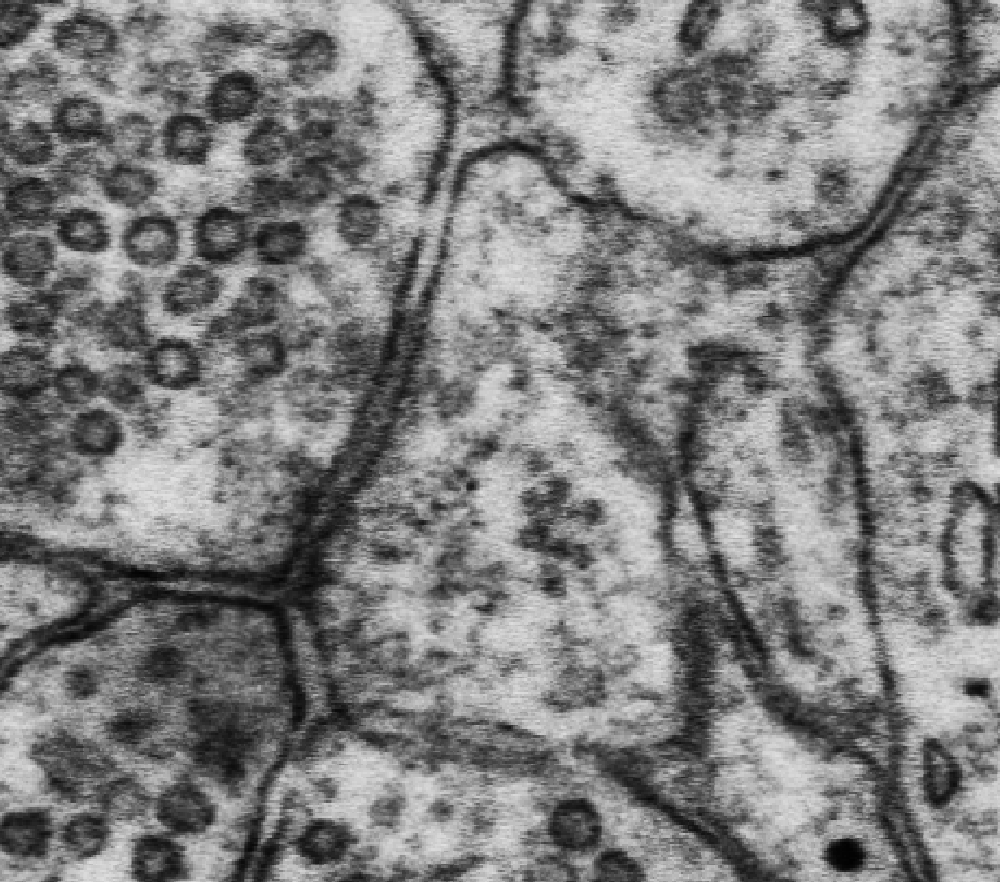
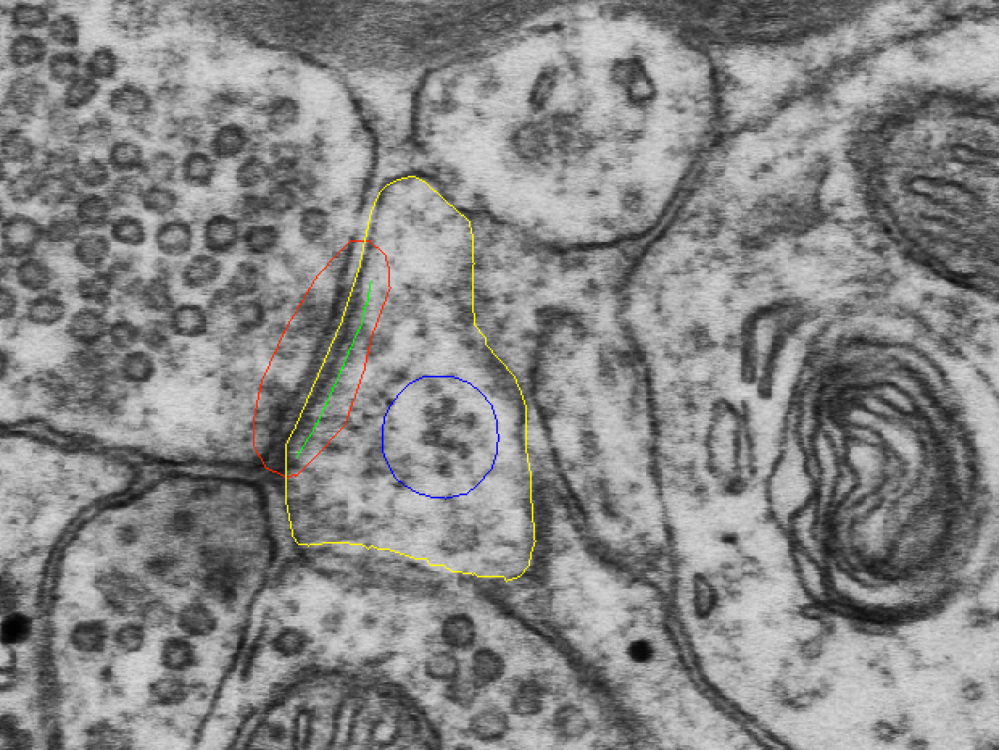
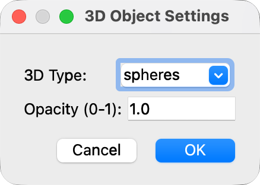
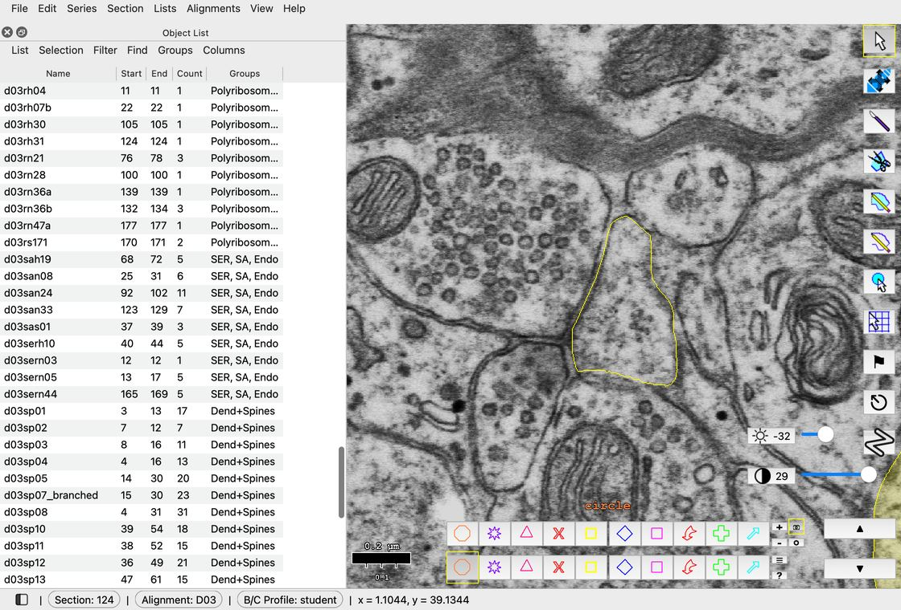
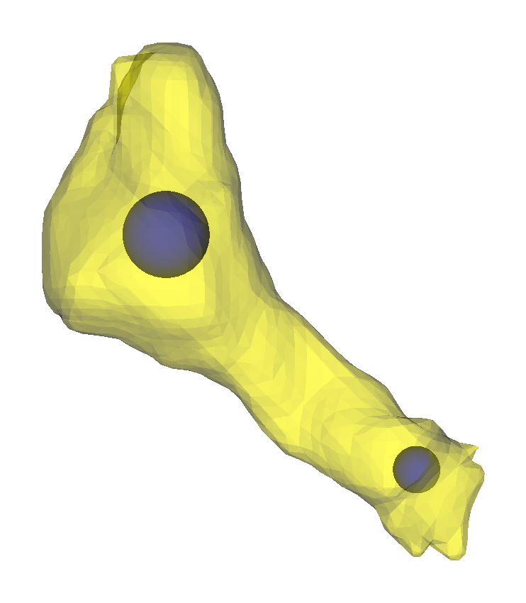
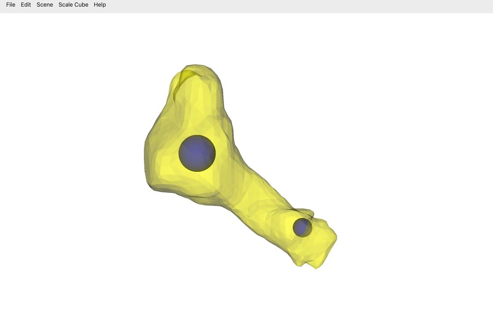

# Lab 3.2: Polyribosomes

NEU466G, Dr. Kirk · [Class documents](index.md)
{ .class-doc-meta }

## Overview

Polyribosomes are clusters of 3 or more ribosomes in close proximity. In EM images, they look like dark round dots (approx. 10-30 nm in width). Because of their small size, individual ribosomes cannot be seen on more than one section, although a particularly large cluster may spread across 2 or 3 sections.

## Identifying polyribosomes in dendritic spines

Here is an example polyribosome (PR) from the class dataset ZGBJY, d03p31.

<figure class="class-fig" markdown="span">
  { width="520" }
  <figcaption>Polyribosomes (red circle) in ZGBJY - d03rh31.</figcaption>
</figure>

## 5 additional spines

**To learn to identify polyribosomes, search in the same 5 spines where you looked for SER and SA:**

- **d03p12**
- **d03p14**
- **d03p37_branched**
- **d03p40**
- **d03p42**

2 of these 5 spines will have polyribosomes.

## Stamp polyribosomes in the 5 spines

Create a trace palette circle with this naming convention: **d03r##** (with r = ribosomes and ## corresponding to spine ##). For example, d03r31 are ribosomes in the spine d03p31.

<figure class="class-fig" markdown="span">
  { width="318" }
  <figcaption>Set Attributes for d03r31.</figcaption>
</figure>

Stamp each polyribosome cluster on a single section where the PR is present. In the case that your spine has multiple PRs, stamp each cluster once (each using the same name and palette attributes) to reconstruct each PR as a sphere in 3D (instructions below).

<figure class="class-fig" markdown="span">
  { width="350" }
  { width="350" }
  <figcaption>Section 124 without traces (left) and with d03sp31, d03c31, d03cfa31 and d03rh31 (right).</figcaption>
</figure>

## Adding polyribosomes to the 3D scene

To view your ribosome stamps in the 3D reconstruction, right-click on the object in the object list > **3D > Edit 3D settings...** > in the drop-down menu set 3D Type to spheres > OK.

<figure class="class-fig" markdown="span">
  { width="219" }
  <figcaption>3D Object Settings.</figcaption>
</figure>

<figure class="clip" markdown>

[▶ 7 s · loops](videos/lab-3-2/3d-spheres.mp4){ .clip-src }

<figcaption markdown>Right-click > 3D > Edit 3D settings... > 3D Type: spheres > OK.</figcaption>
</figure>

Add polyribosomes to the 3D scene by right clicking on the object in the object list > **3D > Add to scene**.

You may need to lower the opacity of your spine object (d03sp##) to about 0.3-0.4 to see the polyribosomes in the 3D scene: right-click it > **3D > Edit 3D settings...** > Opacity (0-1). The opacity changes right away.

<figure class="class-fig" markdown="span">
  { width="371" }
  <figcaption>d03sp31 at opacity 0.4, with polyribosomes d03rh31 (head) and d03rb31 (base).</figcaption>
</figure>

<figure class="clip" markdown>

[▶ 7 s · loops](videos/lab-3-2/3d-turn.mp4){ .clip-src }

<figcaption markdown>Drag in the 3D window to turn the scene.</figcaption>
</figure>
