# PyReconstruct User Guide

PyReconstruct is a desktop application for tracing, annotating, and
3D-reconstructing serial-section and volume electron-microscopy (EM) data. This
guide covers installing the app, opening and building a series, the tracing
tools, the data lists, alignment, 3D reconstruction, and backups.

This guide describes the application as it currently behaves in this
distribution. It complements the in-app help (**Help ▸ Online resources ▸
PyReconstruct user guide**, which opens the
[lab wiki](https://wikis.utexas.edu/display/khlab/PyReconstruct+user+guide) at
The University of Texas at Austin) and the in-app **Help ▸ Shortcuts list**.

> **About screenshots.** The screenshots show PyReconstruct on macOS with a small
> test series. A script in the source tree (`dev/docs_media/capture/capture.py`)
> shoots the app screenshots again when PyReconstruct changes.
>
> Contributions of screenshots are welcome. See [CONTRIBUTING.md](https://github.com/dustenhubbard/PyReconstruct/blob/main/CONTRIBUTING.md).

> **Shortcuts.** Key combinations shown here are the **defaults**. Almost all of
> them are rebindable under **Help ▸ Shortcuts list** (press `?`). A few menu
> shortcuts are fixed: `PgUp`/`PgDown` (section navigation) and `?` (the shortcuts
> list itself). This guide writes `Ctrl` and `Alt`; on macOS press `Cmd` and
> `Option`. [Keyboard shortcuts](#13-keyboard-shortcuts) lists both forms.

---

## Contents

1. [Installing PyReconstruct](#1-installing-pyreconstruct)
2. [Keeping PyReconstruct up to date](#2-keeping-pyreconstruct-up-to-date)
3. [Core concepts](#3-core-concepts)
4. [Opening and creating a series](#4-opening-and-creating-a-series)
5. [The main window and navigation](#5-the-main-window-and-navigation)
6. [The tool palette](#6-the-tool-palette)
7. [The trace palette](#7-the-trace-palette)
8. [Working with traces](#8-working-with-traces)
9. [Data lists](#9-data-lists)
10. [Alignment](#10-alignment)
11. [3D reconstruction](#11-3d-reconstruction)
12. [Saving and backups](#12-saving-and-backups)
13. [Keyboard shortcuts](#13-keyboard-shortcuts)
14. [Getting help](#14-getting-help)
15. [Credits](#credits)

---

## 1. Installing PyReconstruct

There are two ways to install PyReconstruct: a one-click installer (recommended
for most users) or a from-source install with `pip` (for developers and other
platforms).

### One-click installers (Windows, macOS, and Linux)

Download the build for your platform from the current stable release, **v1.25.0**.
Windows, macOS, and the Linux AppImage include Python. Each link below downloads
that platform's installer directly; every build, its SHA-256 checksum, and past
versions are on the
**[Releases page](https://github.com/dustenhubbard/PyReconstruct/releases/latest)**.

- **Windows**:
  [`PyReconstruct-1.25.0-Windows-x86_64-Setup.exe`](https://github.com/dustenhubbard/PyReconstruct/releases/download/v1.25.0/PyReconstruct-1.25.0-Windows-x86_64-Setup.exe).
  This is a per-user installer (no administrator rights required). Builds are
  unsigned for now, so Windows SmartScreen may warn that the publisher is
  unknown; choose **More info ▸ Run anyway**. Re-running a newer installer
  upgrades the existing installation in place.
- **macOS**: open the `.dmg` and drag **PyReconstruct** onto the **Applications**
  shortcut. PyReconstruct is signed and notarized by Apple, so the first launch
  shows the usual question for an app downloaded from the internet. Click **Open**.

  Versions before 1.24.0 were not signed. To open one of those, clear the
  quarantine flag once in Terminal:

  ```
  xattr -dr com.apple.quarantine /Applications/PyReconstruct.app
  ```

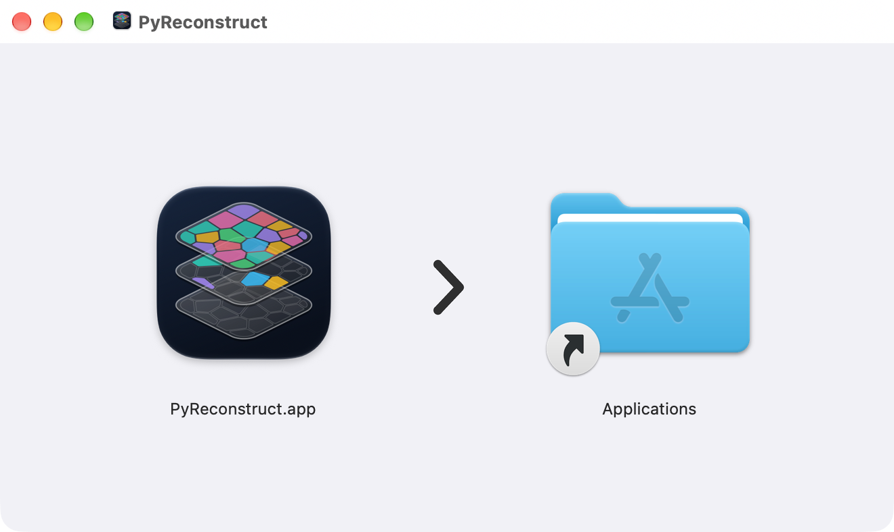

Both macOS builds are native:
[`PyReconstruct-1.25.0-macOS-arm64.dmg`](https://github.com/dustenhubbard/PyReconstruct/releases/download/v1.25.0/PyReconstruct-1.25.0-macOS-arm64.dmg) for
Apple Silicon and
[`PyReconstruct-1.25.0-macOS-x86_64.dmg`](https://github.com/dustenhubbard/PyReconstruct/releases/download/v1.25.0/PyReconstruct-1.25.0-macOS-x86_64.dmg) for an
Intel Mac. The in-app updater serves each Mac its matching architecture.

- **Linux**: install the AppImage with one command:

  ```
  curl -fsSL https://pyreconstruct.org/install.sh | bash
  ```

  It needs no root and no Python. It adds a `pyreconstruct` command and a menu
  entry. Re-run it to update. For PyReconstruct Dev, end the command with
  `bash -s -- --dev`. To uninstall, end it with `bash -s -- --uninstall`. You can
  also download
  [`PyReconstruct-1.25.0-linux-x86_64.AppImage`](https://github.com/dustenhubbard/PyReconstruct/releases/download/v1.25.0/PyReconstruct-1.25.0-linux-x86_64.AppImage)
  and run it directly, or install from source with a system
  **Python 3.11, 3.12 or 3.13**:

  ```
  curl -fsSL https://pyreconstruct.org/install-from-source.sh | bash
  ```

  If FUSE is missing, PyReconstruct still starts, only more slowly, and the
  installer names the package that speeds it up.

### From source (other platforms and developers)

PyReconstruct requires **Python 3.11, 3.12 or 3.13**. Its native dependencies are
tested on those versions (the project pins `>=3.11,<3.14`). Your
system `python3` may be newer, and installing against it will fail; the steps
below get you 3.11 without changing your system Python (use `--python 3.12` or
`--python 3.13` in place of `--python 3.11` for those). The recommended tool is
[uv](https://docs.astral.sh/uv/), which downloads Python 3.11 for you. Install
it with `curl -LsSf https://astral.sh/uv/install.sh | sh` (or `brew install uv`).

For a quick, non-editable install into a fresh 3.11 environment:

```
uv venv --python 3.11 && source .venv/bin/activate   # Windows: .venv\Scripts\activate
uv pip install git+https://github.com/dustenhubbard/PyReconstruct
PyReconstruct
```

`pip` pulls in the runtime dependencies (PySide6, VTK, vedo, NumPy, SciPy,
scikit-image, shapely, trimesh, zarr, and others). If you already have
`python3.11` on PATH, plain `venv` works instead of `uv`: `python3.11 -m venv
.venv && source .venv/bin/activate`, then `pip install git+…`.

To **track the latest unreleased code on `main`** (what the retired in-app
"Developer" channel used to offer), clone the repository and let uv build the
environment from the committed `uv.lock`. This is the canonical developer setup:
`uv sync` reads the checkout's `.python-version` (3.11), provisions the
interpreter, and installs the exact pinned dependency set. To use 3.12 or 3.13
instead, set `UV_PYTHON=3.12` (or `3.13`) in your shell before `uv sync` and `uv run`.

```
git clone https://github.com/dustenhubbard/PyReconstruct
cd PyReconstruct
uv sync                            # creates .venv from uv.lock (exact pinned deps)
uv run PyReconstruct               # launch
```

To move to the newest `main` later: `git pull`, then `uv run PyReconstruct`.
There is no manual reinstall step, because `uv run` re-syncs `.venv` to the
lockfile automatically.

If you prefer a plain `venv` and already have `python3.11` on PATH, an editable
install works too, though it resolves dependencies fresh rather than from
`uv.lock`: `python3.11 -m venv .venv && source .venv/bin/activate`, then
`pip install -e .` (rerun only when `pyproject.toml` changes; a bare `git pull`
otherwise suffices).

For a full development setup (test suite, dev tooling, the parallel conda
`pyrecon_dev` environment, code layout), see
[CONTRIBUTING.md](https://github.com/dustenhubbard/PyReconstruct/blob/main/CONTRIBUTING.md)
and [DEV_UV.md](DEV_UV.md).

### Launching the app

- From an installer: launch **PyReconstruct** like any other installed application.
- From a source install: run `PyReconstruct` on the command line.

The command accepts a few optional flags, e.g. `PyReconstruct -f path/to/series.jser`
to open a series directly on launch. (Run `PyReconstruct --help` for the full
list.)

---

## 2. Keeping PyReconstruct up to date

The frozen Windows and macOS one-click builds can update themselves from within the
app. The updater downloads the new build from GitHub Releases and **verifies it
against a published SHA-256 checksum before installing**. If the checksum can't be
reached or doesn't match, nothing is installed. (On Linux, re-run the install
command to update; see [Installing PyReconstruct](#1-installing-pyreconstruct).)

### Update channels

Two apps install side by side, each following its own update channel:

- **PyReconstruct: Stable.** Stable builds tagged `vX.Y.Z`, for everyday work.
- **PyReconstruct Dev: Nightly.** Early features with less testing, tagged
  `vX.Y.Z.devYYYYMMDD` (for example `v1.24.0.dev20260927`). A new build is
  scheduled daily when there are new commits.

The channel follows the app and cannot be changed in a series. Use
the **Help** menu's download link to install the other app. Each app
only offers updates from its own channel, so updating Dev keeps Stable in
place. Nightlies skip the What's New popup; their release notes list the
changes since the previous nightly.

### Checking for updates

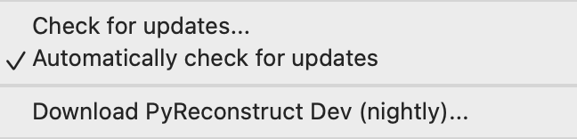

Choose **Help ▸ Check for updates…**. On an installed build, PyReconstruct checks
GitHub Releases on the app's channel (off the main thread, so the UI stays
responsive). If a newer build is found, an update dialog opens showing the new
version, the download size, and a link to the release notes, with a
**Download & Install** button. After verifying the download, PyReconstruct
asks to save any unsaved work, closes, and opens the installer. Complete
installation, then launch the app again. Canceling the close also cancels
the installation.

If you are already current, you'll see a brief "You're already up to date"
message; if no installer exists for your platform on that channel, it tells you so.

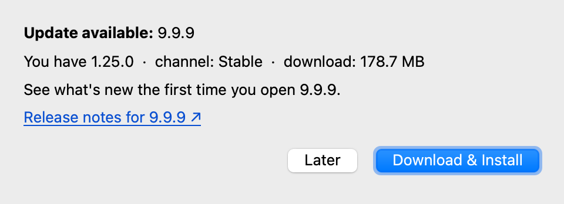

The picture shows an example offer. Version 9.9.9 does not exist.

### Checking automatically on startup

Under **Help ▸ Automatically check for updates** you can turn the startup
check on or off. It is **on by default**. When enabled, an installed build does a quiet
background check at most **once per day**; if an upgrade is available,
**Update available** and the version appear on the right of the status bar. The
notice stays, across launches too, until you click it; clicking it opens the
update just like **Help ▸ Check for updates…**. Turning the automatic check off
also removes the notice.

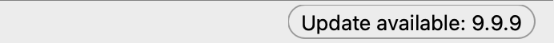

### Source / `pip` installs

For a from-source install, **Help ▸ Check for updates…** instead reinstalls
PyReconstruct from a chosen Git branch with `pip` and then restarts. A prompt
asks for the branch, starting with your saved choice or `main`. The
channel/installer machinery above applies only to packaged builds.

The same reinstall is available from the command line: `PyReconstruct --update`
(reinstall the current branch) or `PyReconstruct --switch <branch>` (change branch,
then reinstall). If you installed editable (`pip install -e .`), a plain `git pull`
is usually all you need. The working tree is what runs. A source install on `main`
is the supported way to follow every commit now that the in-app Developer channel
has been removed.

---

## 3. Core concepts

PyReconstruct is organized around serial-section microscopy: a block of tissue is
cut into an ordered stack of thin sections, each imaged, and structures are traced
through the stack.

- **Series**. A complete project: an ordered set of sections plus series-wide
  settings. You work on one series at a time. A series is stored as a single
  `.jser` file (see below).
- **Section**: one cross-section in the stack. Each section has an index, a
  background **image**, a **magnification** (`mag`, in µm per image pixel), a
  **thickness** (in µm), brightness/contrast, and its own set of traces.
- **Trace**: a single connected shape or curve drawn on one section. A trace can
  be **closed** (an outline enclosing area, e.g. a cell cross-section) or **open**
  (a curve with length but no enclosed area, e.g. a process or a measurement line).
- **Contour**: all traces with the same name **on a single section**.
- **Object**: all traces with the same name **throughout the whole series**.
  Objects are what you reconstruct in 3D and measure in the object list.
- **Z-trace**: a single curve that runs **across sections** (its points carry a
  section index), used to measure distances through the volume.
- **Flag**: a labeled, optionally colored marker placed at a point on a section,
  with comments and a resolved/unresolved state. Flags are useful for to-do notes,
  questions, and review.
- **Transform**. A section's affine transform, six numbers `a b c d e f`: `a b d
  e` give rotation/shear/scale and `c f` give x/y translation. The **same**
  transform is applied to the section's image *and* its traces, so traces stay
  fixed to the image. Moving the alignment moves image and traces together.
- **Alignment**: a named set of per-section transforms across the whole series. A
  series can hold several alignments and you can switch between them. (See
  [Alignment](#10-alignment).)
- **Host / traveler**. An optional parent/child relationship between objects: an
  object can be hosted by ("ride on") another object. Used to keep related
  structures organized and to group them in the 3D scene.

### The `.jser` file

A series is saved as a single `.jser` file. It is a JSON document with the
series-level settings, the per-section data (including each section's image
filename, magnification, and thickness), and the edit log. **The `.jser` does not
contain the images themselves**: it stores image filenames, and the actual image
files live in the series' image source directory. While a series is open,
PyReconstruct unpacks it into a hidden working folder next to the `.jser` and
repacks on save.

### Images and Zarr

Supported image formats for sections are **JPG/JPEG, PNG, TIF/TIFF, and BMP**.

For large images, PyReconstruct can use multiscale **Zarr** image stores, which
load only the parts of the image needed for the current view (rather than the
whole image on every section change). You can convert a series' images to scaled
Zarr from **Series ▸ Images ▸ Convert to scaled images** (see
[Opening and creating a series](#4-opening-and-creating-a-series)).

---

## 4. Opening and creating a series

### On first launch

With no file specified, PyReconstruct opens a **welcome series**, a small
read-only demo you can use to explore the interface. The welcome series cannot be
saved or backed up; create or open a real series to begin work. A **username** is
resolved automatically and recorded against the edits you make. PyReconstruct no
longer prompts for it on launch; change it anytime under **File ▸ Change
username…**.

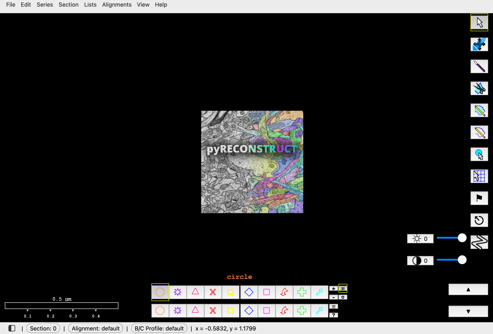

### Opening an existing series

**File ▸ Open series…** (`Ctrl+O`) opens a `.jser` file. Recently opened series
are listed under **File ▸ Open recent series**, most recently opened first (by
when you opened them, not by file date); the list holds ten entries, drops paths
that no longer exist, and can be emptied with **Clear recents** at the bottom of
that submenu. **File ▸ Close series** returns to the welcome series (it does not
quit the app).

<figure class="clip" markdown>

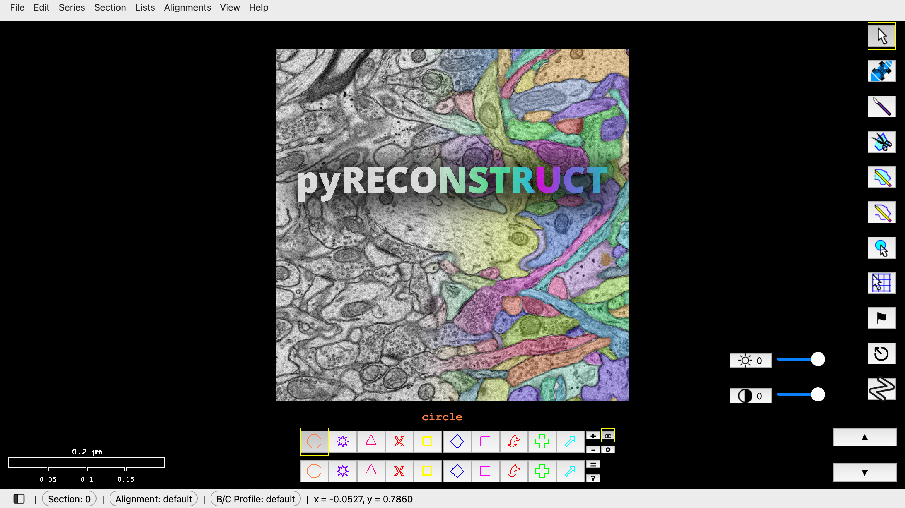{ data-width="1280" data-height="720" }

[▶ 6 s · loops](assets/videos/user-guide/04-open-series.mp4){ .clip-src }

<figcaption markdown>**File ▸ Open series…**, then pick the `.jser` file. The file dialog is left out here.</figcaption>
</figure>

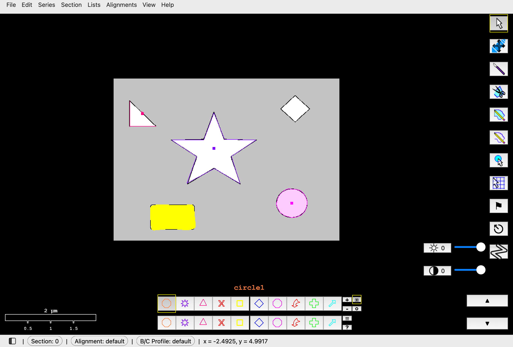

If a series' image files can't be found when it opens, PyReconstruct asks whether
you'd like to locate them and lets you pick the image folder (you can also do this
later via **Series ▸ Images ▸ Find/change image directory**).

**Recovering an unsaved session.** If a series was left open or not saved cleanly
(for example after a crash), reopening it detects the leftover working folder and
offers to recover the unsaved session. If the same series appears to be open in
another window (it was touched within the last few seconds), PyReconstruct shows
**"Series In Use"** and declines to open a second copy.

### Creating a new series from images

**File ▸ New series ▸ From images…** (`Ctrl+N`) walks you through:

1. **Select images**: choose the section image files (JPG/JPEG, PNG, TIF/TIFF,
   BMP). The files are sorted alphanumerically, and that order becomes the section
   order (section 0, 1, 2, …), so name your images so they sort correctly.
2. **Series name**: used to name the series.
3. **Image calibration (µm/px)**: microns per image pixel. Default **0.00254**.
4. **Section thickness (µm)**: default **0.05**. Thickness feeds the volume and
   flat-area calculations in the object list.

The new series opens fitted to the first image; you are then prompted to choose
where to save the `.jser`.

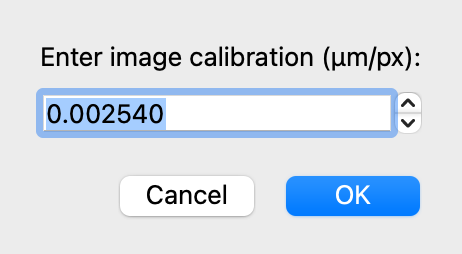

### Other ways to create a series

Also under **File ▸ New series**:

- **From scaled images…** builds from an existing scaled Zarr directory (expects
  a `scale_1` folder), then runs the same name/calibration/thickness prompts.
- **From legacy .ser…** creates a series from legacy *Reconstruct* XML `.ser` files.
- **From neuroglancer zarr…** creates a series from a Neuroglancer Zarr.

### Image directory and Zarr conversion

Under **Series ▸ Images**:

- **Find/change image directory** points the series at the folder containing its
  images. The chosen directory is remembered with the series.
- **Convert to scaled images** converts the series' images into a scaled
  (`.zarr`) store for faster loading of large images.
- **Update image scales** adds or refreshes scale levels on an existing Zarr.

### When a Zarr names its images differently

A Zarr made from a series' images may name them differently from the series,
for example `IMG_000.tif` in the series and `000_IMG_grid000.tif` in the Zarr.
The series then shows no images, even with the right Zarr chosen.

Choose the Zarr in **Series ▸ Images ▸ Find/change image directory**. If none of
the series' image names is in the Zarr, PyReconstruct tries to pair each section
with one Zarr image by the number in its image name:

- It uses the first or the last number in each name. Zero padding does not
  count, so `001` and `1` are the same number.
- Each number must appear once on each side, and both sides must have the same
  numbers. An extra image, a missing image or an offset (for example images
  numbered 1 to 100 against 0 to 99) is refused.
- If the first and the last number both fit but pair the images differently,
  the match is refused, since which one is meant is not clear.
- The pairing uses the number in the series' own image name, not the section
  number. After you insert, remove or reorder sections, the two can differ.

If the names cannot be paired, a message says why and no names change. If even
one series image name is already in the Zarr, PyReconstruct treats the rest as
missing images and offers no pairing.

If the names pair, a **Match Image Names** window lists each section with its
current image name and the Zarr name it would get. It draws a few sections'
traces over the proposed images so you can check the fit by eye. Sections whose
image number is not their section number are flagged and drawn first.

- **Use these names** gives each section its Zarr image name. The series file
  changes when you save.
- **Cancel** changes no names. The series still points at the chosen Zarr, so
  its images still do not show.

Matching the names only reads the Zarr. Nothing in it is renamed, moved or
written, so other series that use the same Zarr are not affected. If the Zarr
has no scale levels yet, PyReconstruct may then ask whether to add them. That
is a separate step: **Yes** writes the new scale levels into the Zarr, and
**No** leaves it as it is.

---

## 5. The main window and navigation

The main window shows the current section's image with its traces drawn on top
(the **field**). Floating overlays sit on top of the field: the **tool palette**
(the column of mode buttons, top-right by default), the **trace palette** (the row
of preset traces, bottom-center), section-increment buttons, brightness/contrast
sliders, and a scale bar. Each overlay group can be dragged to reposition it, and
**View ▸ Reset palette position** restores the defaults.

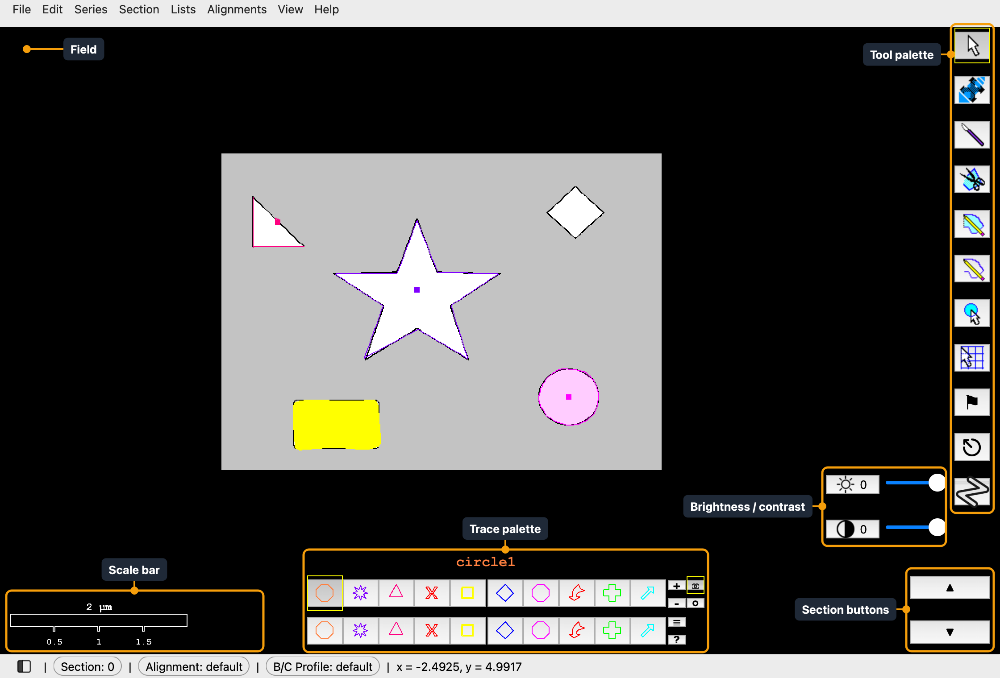

### Moving between sections

- **Page Up** / **Page Down**: next / previous section.
- **Mouse wheel** over the field: scroll up for the next section, down for the
  previous (works in any tool mode).
- **Go to section** (`Ctrl+G`): jump to a section number.
- The section-increment buttons (▲/▼) in the corner do the same as PgUp/PgDown
  (handy on tablets).

<figure class="clip" markdown>

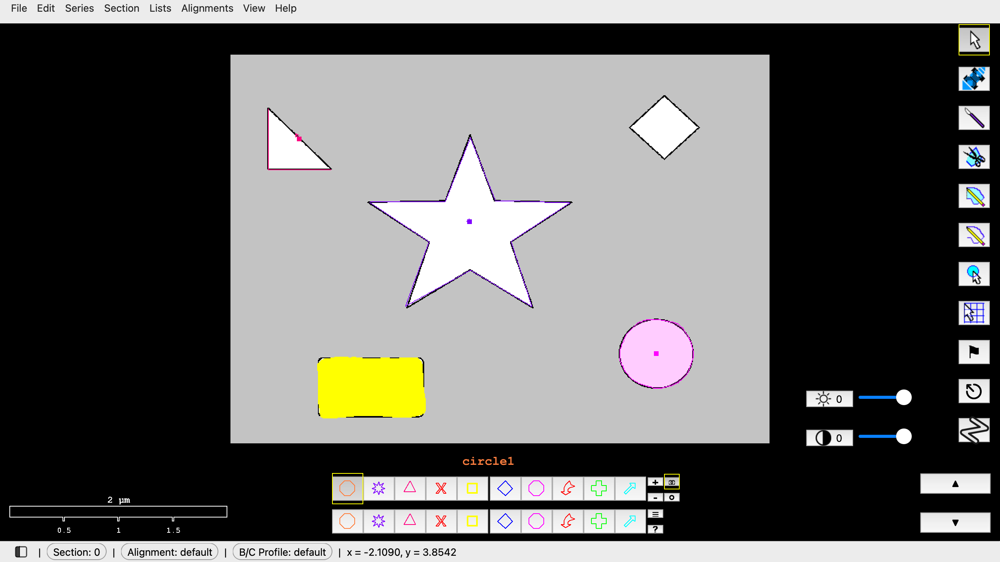{ data-width="1280" data-height="720" }

[▶ 6 s · loops](assets/videos/user-guide/05-move-between-sections.mp4){ .clip-src }

<figcaption markdown>**Click ▲ for the next section and ▼ for the previous one.**</figcaption>
</figure>

### Panning and zooming (in any tool)

- **Middle-click and drag**: pan the view.
- **Ctrl + mouse wheel**: zoom about the cursor.
- **Home**: fit the view to the image. **View ▸ View magnification…** sets an
  exact zoom (useful for consistent figure scale).

The dedicated **Pan/Zoom** tool (below) is an alternative when a middle mouse
button isn't available.

### Brightness and contrast

Adjust the current section with the corner sliders, or with the keyboard:
brightness `=` / `-`, contrast `]` / `[` (also under **Edit ▸ Brightness/contrast**).
Named brightness/contrast profiles are available under **Series ▸ Brightness/contrast
profiles…**.

### Showing and hiding interface elements

Under **View ▸ Palette ▸ Visibility** you can independently toggle the trace
palette, the section-increment buttons, the brightness/contrast sliders, and the
scale bar. **View ▸ Left handed** swaps the tracing-pencil cursor side.

### Theme

**View ▸ Change theme** offers **Default** and **Dark**. (The theme can also be set
under **Series ▸ Options**.)

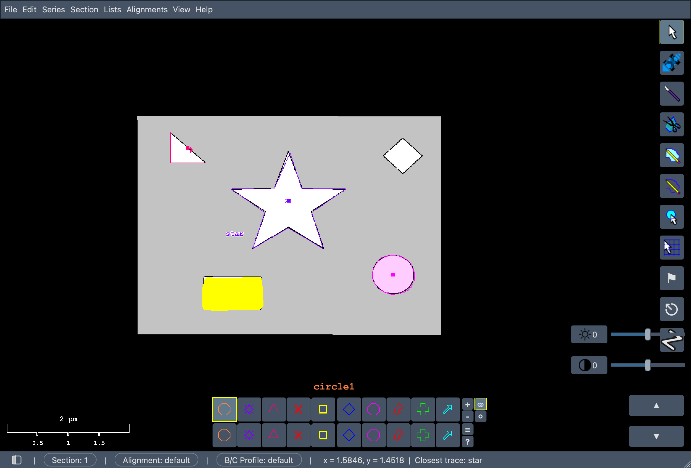

---

## 6. The tool palette

The tool palette is the column of mode buttons (top-right by default). Click a
button (or press its shortcut) to switch the active tool. **Right-clicking a
tool button opens that tool's settings** (where it has any).

In every tool except Pan/Zoom, **right-clicking the field** opens a context menu
(for the selected traces, or for the field). The mouse wheel changes sections, and
middle-click pans, regardless of the active tool.

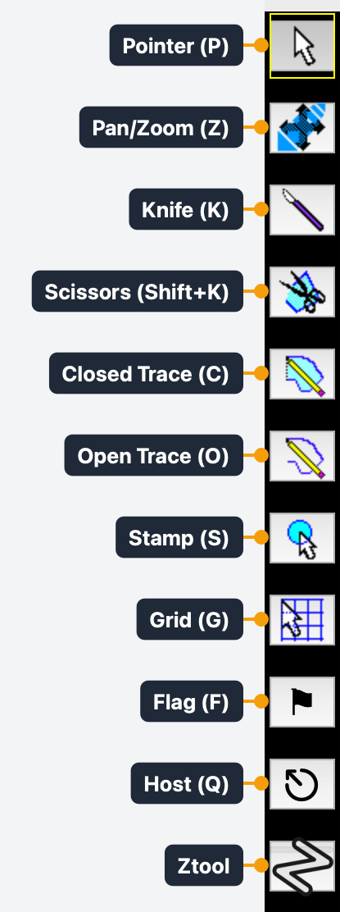

<!-- generated: tools (from PyReconstruct's source; to update, run: python3 scripts/docs_tables.py --write) -->
The palette has eleven tools, top to bottom:

| Tool | Key |
|---|---|
| Pointer | `P` |
| Pan/Zoom | `Z` |
| Knife | `K` |
| Scissors | `Shift+K` |
| Closed Trace | `C` |
| Open Trace | `O` |
| Stamp | `S` |
| Grid | `G` |
| Flag | `F` |
| Host | `Q` |
| Ztool | (none) |
<!-- /generated: tools -->

### Pointer (`P`)

Selects and moves traces, z-trace points, and flags.

- **Click** a trace to select/deselect it.
- **Click and drag on empty space** to draw a selection region. By default this is
  a freehand **lasso** that selects only fully-enclosed traces; right-click the
  Pointer button to switch the region shape (**Rectangle**/**Lasso**) and whether
  it selects **all touched** traces or **only completely encircled** ones.
- **Click and drag a selected trace** to move all selected items together.

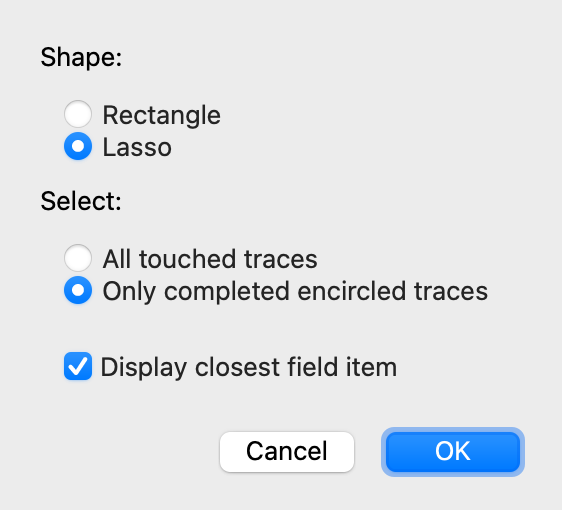

### Pan/Zoom (`Z`)

- **Drag** with the left button to pan.
- **Drag up/down** with the right button to zoom.

(Pan and zoom are also available in any tool via middle-click and Ctrl+wheel.)

### Knife (`K`)

Slices a selected trace along a freehand line.

- Select the trace(s) to cut first (they must share one object name and be all
  open or all closed), then **drag** the knife across them.
- Resulting pieces smaller than a threshold percentage of the original are
  discarded. Right-click the Knife button to set **% original trace** (default
  **1.0**) and to enable **Smooth cuts**.
- A press of another mouse button part way through a cut is ignored, so a
  drawing tablet's barrel button cannot cancel the stroke or open the field menu
  over the object. Clear **Ignore the other mouse buttons** in the same
  right-click dialog to get the older behavior, where the second press abandons
  the cut and opens the menu.
- A trace whose outline crosses itself cannot be cut. The knife says so and
  leaves the object alone; smooth or redraw the trace and cut again.

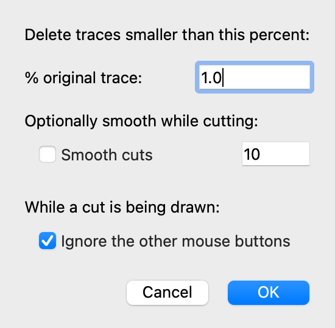

### Scissors (`Shift+K`)

Re-traces an existing trace. **Click a trace** and the tool reopens it as a live
line starting at the clicked point, so you can re-draw it; **right-click** to
finish. Useful for fixing part of a contour without redrawing the whole thing.

### Closed Trace (`C`) and Open Trace (`O`)

Draw new traces with the current trace-palette preset's name and color. **Closed
Trace** makes outlines that enclose area; **Open Trace** makes curves with length
only.

<figure class="clip" markdown>

{ data-width="1280" data-height="720" }

[▶ 8 s · loops](assets/videos/user-guide/06-draw-closed-trace.mp4){ .clip-src }

<figcaption markdown>**Click Closed Trace (or press `C`), then drag a loop and let go.** The trace takes the selected preset's name and color.</figcaption>
</figure>

Right-click either button to choose the drawing **mode**:

- **Scribble**: hold and drag to draw freehand; release to finish.
- **Poly**: click to place each vertex; **right-click to finish**; **Backspace**
  removes the last point.
- **Combo** (default): a quick click starts a poly/clicked line; click-and-drag
  scribbles.

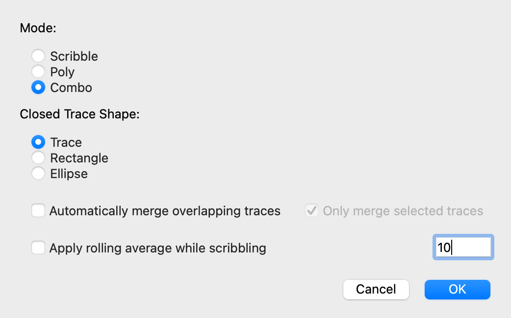

For **Closed Trace** you can also pick a fixed **shape** (freehand **Trace**,
**Rectangle**, or **Ellipse**; drag to size) and optionally auto-merge new traces
into selected same-named traces, or apply a rolling-average smooth while
scribbling.

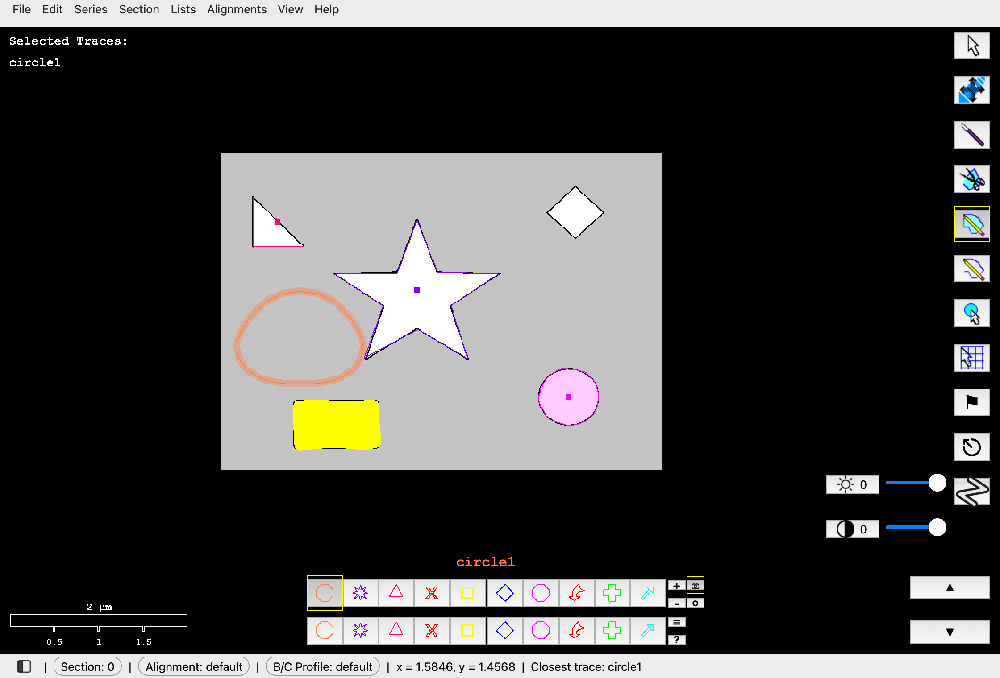

### Stamp (`S`)

Places a copy of the current trace-palette preset's shape at a fixed size.

- **Click** to drop one stamp centered on the cursor at the preset's radius.
- **Click and drag** to set the radius for that stamp (diameter = drag distance).

The stamp shape and its radius come from the selected trace-palette button (set
them by right-clicking that button; see [The trace palette](#7-the-trace-palette)).

### Grid (`G`)

Replicates the current preset into a rectangular array, useful for stereology
sampling. **Click** to place the grid. Right-click the Grid button to set the
element size, spacing, and number of columns/rows. With **Sampling frame** enabled
(the default), each cell is drawn as a counting frame (a red exclusion line and a
green inclusion line) rather than a copy of the preset.

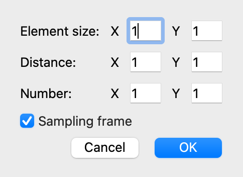

### Flag (`F`)

Drops a labeled marker (a `⚑` glyph) at the clicked point. **Click** to place a
flag and fill in its name, color, and an optional comment. Right-click the Flag
button to set the default name/color, the flag size, and which flags are shown:
**All flags**, **Only unresolved flags** (the default), or **No flags**.

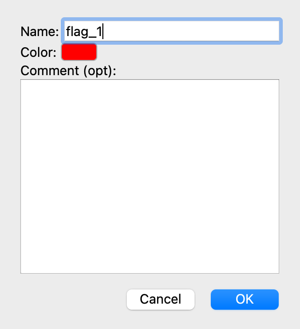

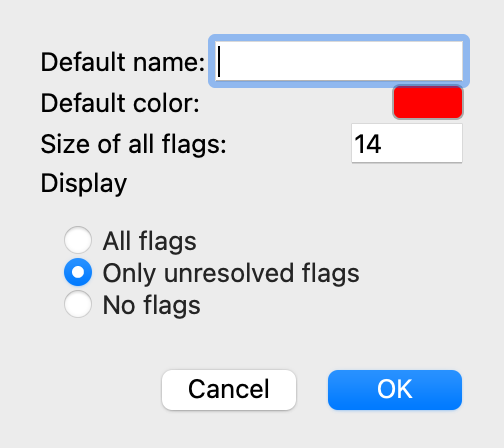

Flags are selected and moved with the Pointer tool; **right-clicking a flag** opens
its dialog, where you can edit its name/color, add comments, and mark it
**Resolved**. All flags in the series are listed in the [Flag list](#9-data-lists).

### Host (`Q`)

Sets host (parent) relationships between objects. **Click a first trace** (the
object that will be hosted), then **click a second trace** (its host); a line is
drawn between them while you choose. **Right-click** to cancel. An object can't host
itself, and two objects can't host each other. Hosts also appear as a column in the
object list and can be set from the object list's context menu.

### Z-trace tool

Creates a [z-trace](#3-core-concepts), a curve through the stack. The palette
names this tool **Ztool**. Select the tool, then **click** points (changing sections between clicks as needed with the
mouse wheel); **right-click to finish**. The new z-trace takes the current
preset's name and color. (This tool is selected from the palette; it has no default
keyboard shortcut.)

---

## 7. The trace palette

The trace palette is the row of preset traces at the bottom of the window. The
selected preset supplies the **name, color, tags, shape, and stamp radius** for new
traces you draw, stamp, or grid. The selected preset's name is shown (in its color)
near the palette.

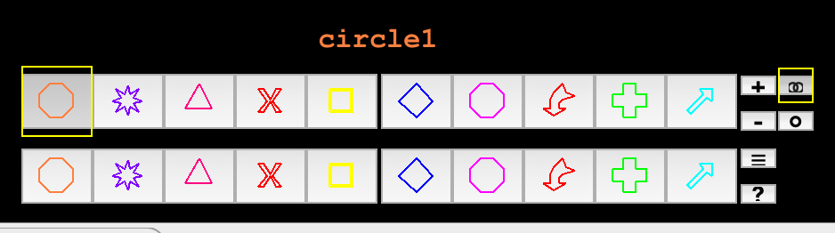

- The default palette has **20 presets**, arranged as two rows of ten.
- Select a preset with the number keys: **`1`–`9`, `0`** for the first row, and
  **`Shift+1`–`Shift+9`, `Shift+0`** for the second.
- **Right-click a preset** (or press `Ctrl`+its number) to edit its attributes:
  name, color, fill mode, tags, the trace **shape**, and the **stamp radius
  (microns)** used by the Stamp and Grid tools.

The small buttons beside the palette let you bulk-increment numbered preset names
(`+`/`−`, applied to all presets or only the active one), open **Modify all
palettes**, and show help. Preset names containing a number pattern can also
auto-increment as you place traces, which is handy for numbering a sequence of
objects.

You can reset the palette (**Series ▸ Trace palette ▸ Reset current palette**) and
export/import palettes as CSV (**Series ▸ Trace palette ▸ Export as CSV… / Import
from CSV…**). **Edit ▸ Paste attributes to palette** (`Shift+G`) sets the current
preset from a copied trace.

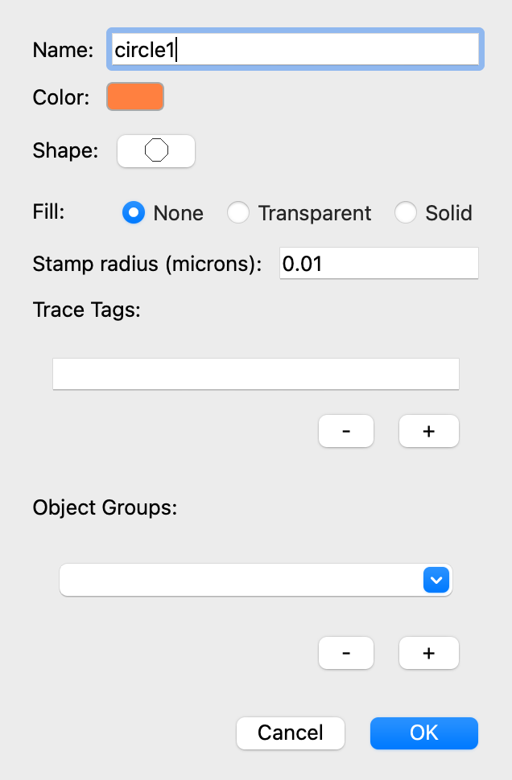

---

## 8. Working with traces

Most trace editing is on the **field context menu** (right-click selected traces),
with keyboard shortcuts for the common actions. Selected-trace actions affect *all*
selected traces. The top of that menu carries a single **Edit ... attributes...**
shortcut that follows your selection: it reads **Edit trace attributes...** when
traces are selected and **Edit z-trace attributes...** when z-traces are, so the
most-used edit is one click away above the per-entity submenus.

- **Edit attributes** (`Ctrl+E`): change name, color, tags, and fill mode.
- **Merge traces** (`Shift+M`): merge the exteriors of selected traces (they must
  share a name).
- **Hide** (`Shift+H`) / **Unhide all** (`Ctrl+U`). Hidden traces can't be edited
  until unhidden.
- **Make negative / positive**. Negative traces subtract from (cut into) the area
  of same-named traces, e.g. to carve a hole; this matters for area and 3D volume.
- **Cut / Copy / Paste** (`Ctrl+X` / `Ctrl+C` / `Ctrl+V`) and **Paste attributes**
  (`Ctrl+Shift+V`; the older `Ctrl+B` still works), which copies a trace's
  name/color/tags onto selected traces.
- **Delete** (`Delete` or `Backspace`): delete the selected traces.


On the field (right-click empty space, or use the shortcuts):

- **Select all** (`Ctrl+A`) / **Deselect** (`Ctrl+D`).
- The **View** submenu items are checkboxes that show their current on/off state;
  each also has a keyboard shortcut that toggles it:
  - **Hide trace layer** (`H`) and **Show all traces (ignore hidden)** (`A`)
    temporarily hide or show every trace regardless of individual hidden state
    (the field border turns red when all are force-hidden, green when all are
    force-shown). These differ from per-trace Hide/Unhide.
  - **Section blend** (`Space`) blends the current and last-viewed section, to
    compare them.
  - **Hide image** (`I`), **Focus mode** (`X`).

In **Focus mode**, a **Ctrl-click** (`Cmd`-click on macOS) on a trace edits which
object it belongs to: clicking a trace of the focused object splits that trace out
into a new `<object>_split` contour, and clicking a trace of any *other* object
incorporates it into the focused one. Both are undoable. **This was Shift-click
before 1.21.0**, and Shift no longer performs the edit. Choose another modifier, or
none, under **Help ▸ Shortcuts list**. Clicking a trace *without* a modifier does nothing in focus mode. The ordinary
click-to-select is suppressed outright while focus mode is on, so an unmodified
click neither selects another object's trace nor deselects one of the focused
object's own.

**Undo** (`Ctrl+Z`) / **Redo** (`Ctrl+Y`) cover actions on the field and actions
taken through the lists, including series-wide edits such as renaming, recoloring,
or changing the radius or shape of an object across every section. When an action
touched more than one section, undo asks whether to revert all of them or only the
current section. Three actions are genuinely not undoable and warn before running:
deleting sections, reordering sections, and optimizing brightness/contrast.

**Find a contour** on the current section with **Section ▸ Find contour…**
(`Shift+F`); jump to an object's first contour anywhere in the series with
**Series ▸ Find first object contour…** (`Ctrl+F`).

---

## 9. Data lists

PyReconstruct provides five list/table windows, plus a series history window, under
the **Lists** menu. Each list opens as a dockable panel (multiple instances are
allowed), and several can be open at once.

| List | Open with | Shows |
|---|---|---|
| **Object list** | `Ctrl+Shift+O` | every object in the series, with quantities and attributes |
| **Object list of selected traces** | (no shortcut) | the objects with a trace selected in the field, with the same columns |
| **Trace list** | `Ctrl+Shift+T` | traces on the **current section** |
| **Section list** | `Ctrl+Shift+S` | every section |
| **Z-trace list** | `Ctrl+Alt+Z` | every z-trace |
| **Flag list** | `Ctrl+Shift+F` | flags across the series |
| **Series history** | (no shortcut) | the full edit log |

### Features shared by the lists

- **Set columns…** lets you choose which columns are shown and reorder them.
- **Export…** writes the displayed columns/rows to CSV.
- **Refresh** reloads from the series data (the object list also auto-refreshes as
  you trace; the trace list tracks the current section and has no separate
  Refresh).
- **Filters**. Most lists filter by a **regex** on the name (where `#` is
  shorthand for a digit), and by **group** and/or **tag** where applicable.
- **Ctrl+C** copies selected cells. **Delete/Backspace** deletes the selected rows'
  underlying data. Right-click a selection for that list's context menu.
- Every list's context menu offers **Invert selection** (select the displayed rows
  that aren't selected, and vice versa; it only ever acts on rows currently shown,
  so an active filter is respected) and **Copy _entity_ values** (named for the list:
  **Copy object values**, **Copy trace values**, etc.; the same as `Ctrl+C`).

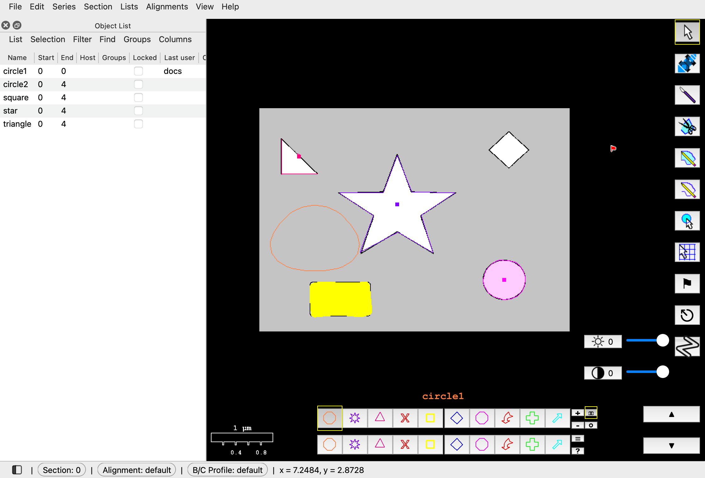

### Object list

<figure class="clip" markdown>

{ data-width="1280" data-height="720" }

[▶ 7 s · loops](assets/videos/user-guide/09-open-object-list.mp4){ .clip-src }

<figcaption markdown>**Lists ▸ Object list** docks the list beside the field. Its close button puts it away.</figcaption>
</figure>

Double-click an object to jump to its first occurrence; **Shift+double-click** adds
it to the 3D scene. Columns include **Name**, **Start/End** (first/last section),
**Count**, **Flat area**, **Volume**, **Radius**, **Host**/**Superhosts**,
**Groups**, **Trace tags**, **Locked**, **Last user**, **Comment**, **Configuration**
(open/closed/mixed), an optional **Curate** state, and any custom **categorical**
columns you define.

- **Flat area** = the summed closed-trace areas plus open-trace lengths × section
  thickness; **Volume** = summed closed-trace areas × section thickness.
- The context menu edits the object across the whole series: edit attributes, set
  comments/hosts/groups/alignment, lock/unlock, create a copy, edit radius/shape,
  smooth, split into individual objects, set curation, manage the object in 3D
  (add/remove/export meshes/export quantitative data/edit 3D settings), create a
  z-trace from it, view history, and delete.
- **Filters**: regex, group, tag, curation, configuration, and host filters.
  **Filter ▸ Selected traces only** limits the list to the objects with a trace
  selected in the field, and the rows update when the selection changes.
- **Find ▸ First / Last** jump to the object's first/last section.
- The **Curate** columns can be toggled across all object lists with
  **View ▸ Toggle curation in object lists** (`Ctrl+Shift+C`).
- **Series ▸ Restore object curation status from log** recovers curation statuses
  the series has lost. Every time you mark an object *Curated* or *Needs curation*
  the series records it twice: on the object, and as an entry in the series log.
  This action reads the log (including entries offloaded with **Series ▸ Log ▸
  Offload log history…**), takes each object's most recent curation entry, and
  writes that status back onto the object. It only fills gaps: an object already
  marked *Curated* is left exactly as it is, and no status is ever cleared or
  downgraded. A restored *Needs curation* keeps who it was assigned to, provided
  the marking was made in a version that records the assignee in the log. Use it
  if curation you know you did is no longer showing, for example after
  recovering an unsaved session. It is one undoable step (`Ctrl+Z`).

### Trace list

Lists traces on the current section (it follows you as you change sections).
Columns include **Name**, **Index**, **Tags**, **Hidden**, **Closed**, **Length**,
**Area**, **Radius**, optional **Centroid** and **Feret** diameters. **List ▸
Export all traces in series…** writes every trace in the series to CSV. The context
menu can edit/smooth/merge traces, set open/closed, make negative/positive, hide,
edit shape/radius, create a flag on a trace, and delete.


### Section list

Lists all sections. Columns: **Section** (number; calibration-grid sections are
marked), **Thickness**, **Locked**, **Brightness**, **Contrast**, **Image Source**.
The context menu locks/unlocks sections, sets brightness/contrast (set, increment,
match to the in-view section, or optimize), edits thickness, edits the image source,
inserts a section above/below, copies, and deletes. **Modify ▸ Section image
sources…** bulk-renames image sources, and **Reorder sections** renumbers them
sequentially.


### Z-trace list

Lists all z-traces. Columns: **Name**, **Start**, **End**, **Distance** (length),
**Groups**, **Alignment**. The context menu edits attributes, smooths, manages the
z-trace in 3D and in groups, changes its alignment, and deletes.

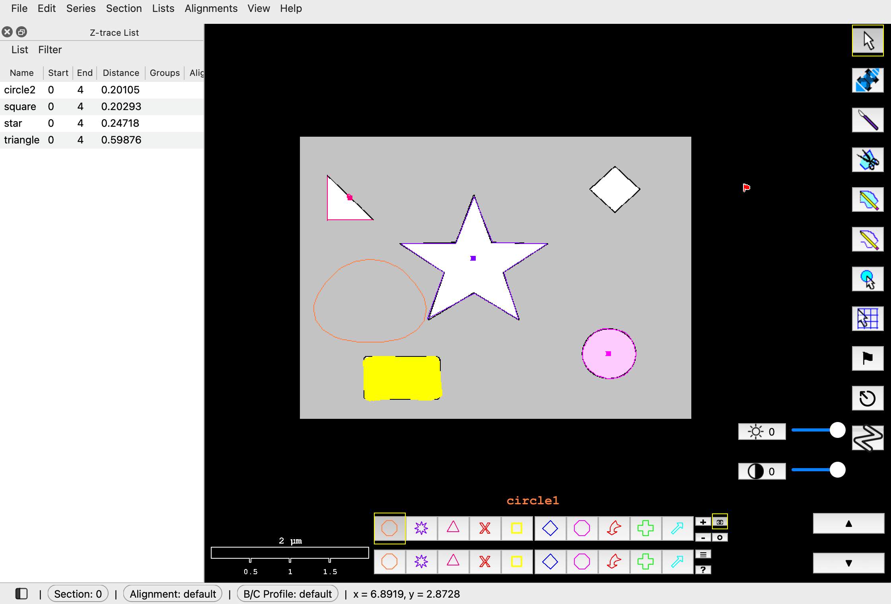

### Flag list

Lists flags across the series; resolved flags are hidden by default. Columns:
**Section**, **Color**, **Flag** (name), **Resolved**, **Last Comment**.
Double-click jumps to the flag. The context menu opens the flag to view/edit and
add comments, marks flags resolved/unresolved, filters by color, copies, deletes,
or deletes all flags with a given name. Filters include showing resolved flags, a
name regex, a color filter, and a comment-text filter.

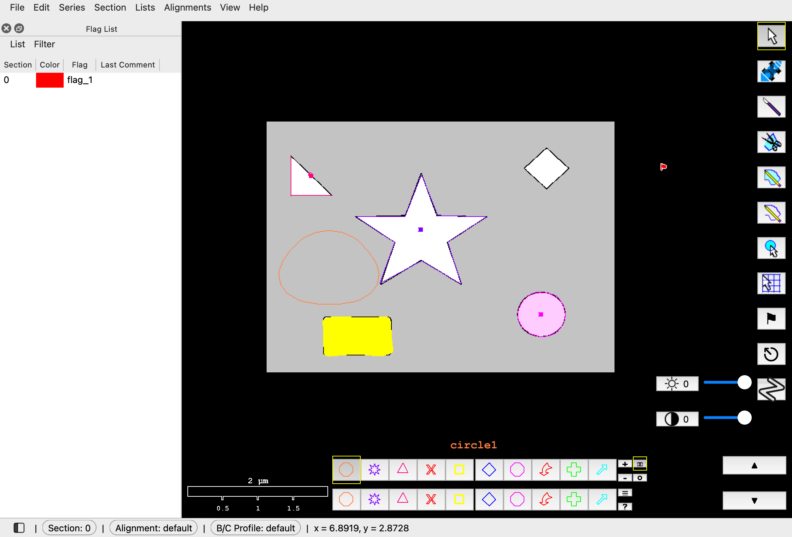

### Series history

**Lists ▸ Series history** opens a read-only **History** window (Date, Time, User,
Object, Sections, Event), newest first. The object list's **View history** shows
the same window filtered to the selected objects. Long histories can be trimmed
with **Series ▸ Log ▸ Offload log history…**, which exports older entries to an
external CSV.

Older versions could write a history row PyReconstruct cannot read back, when a
name had a line break or a comma in it. From a source install,
`PyReconstruct --check-history path/to/series.jser` lists those rows with the line
and text of each. Give it a folder to check every .jser in it and its subfolders.
It only reads the files and changes nothing.

---

## 10. Alignment

An **alignment** is a named set of per-section transforms. The currently active
alignment determines how each section's image and traces are positioned. Switching
alignments never changes the underlying images or trace coordinates, only how they
are displayed.

Every series includes a special **`no-alignment`** entry (the identity transform).
It can't be edited, renamed, or deleted, and you can't edit transforms while it is
active. Switch to a real alignment first.

### Switching and managing alignments

- **Switch** the current alignment from the field's right-click menu (**Series
  alignment** submenu), which lists every alignment as a checkable item.
- **Alignments ▸ Edit alignments…** (`Ctrl+Shift+A`) opens the alignment dialog,
  where you can create a **New** alignment (created as a copy of the current one),
  **Rename**, or **Remove** alignments. Objects can also carry a per-object
  alignment override (**Edit alignment…** in the object list).

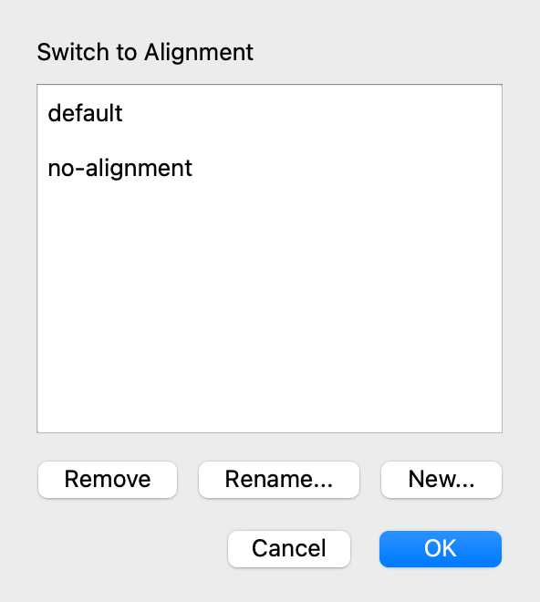

### Adjusting a section's transform

- **Alignments ▸ Edit transformation** (`Ctrl+T`): enter the six transform numbers
  `a b c d e f` directly. (Blocked on locked sections and while in `no-alignment`.)

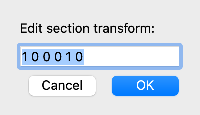

- **Keyboard nudges** (when no traces are selected, these move the section's
  transform; otherwise they move the selected traces):
  - Arrow keys: translate (medium step); `Ctrl`+arrows = small, `Shift`+arrows =
    big. Step sizes are set in **Series ▸ Options**.
  - `Ctrl+Shift+Left` / `Ctrl+Shift+Right`: rotate about the cursor.
  - `F1`–`F4` (with `Shift` to reverse): scale and shear in X/Y.

### Assisted alignment

- **Estimate affine transform** aligns the current section to the comparison ("B")
  section from matched traces. Select **3 or more** traces of the same name on both
  sections (the same number on each); PyReconstruct computes the affine transform
  that best maps one set of centroids onto the other.
- **Align by correlation** (`Ctrl+\`) automatically registers the current image to
  the section beneath it by image cross-correlation (a translation-only adjustment).
- **Propagate transform** records a transform adjustment and applies it across many
  sections: **Start propagation recording**, make your adjustment, then **Propagate
  to start** / **Propagate to end** (or simply navigate; while recording, moving to
  a new unlocked section applies the recorded change). A red dot is shown on the
  field while recording. Locked sections are skipped.

### Align by correlation, then propagate across a range

The `Ctrl+\` correlation shift can be recorded and propagated across a range of
sections, exactly like a manual transform, but **you must start recording before
you correlate**:

1. Navigate to the section you want to align.
2. **Alignments ▸ Propagate transform ▸ Start propagation recording**.
3. Press `Ctrl+\` (**Align by correlation**). This aligns the current section and
   records the shift.
4. Either navigate through the sections (each unlocked section you visit receives
   the recorded shift) or use **Propagate to start** / **Propagate to end** to apply
   it across a bulk range at once.
5. **Alignments ▸ Propagate transform ▸ End propagation recording**.

Order matters: starting recording resets the accumulator, so pressing `Ctrl+\`
*before* you start recording will not capture that alignment. Always start
recording first. As with manual transforms, locked sections are skipped during
propagation.

### Importing transforms

**Alignments ▸ Import alignments**:

- **Another series (.jser)**: choose a series, then choose which of its alignments
  to bring over and what to call each one here. Each name starts out the same as
  it is in the other series; type over it to import under a different name.
  Importing under a name this series already uses replaces that alignment on every
  section, and PyReconstruct names the alignments at risk and asks before it does.
  Differing calibrations are flagged first, and transforms are rescaled to this
  series' pixel size. Sections missing from the other series get an identity
  transform.
- **.txt file**. One line per section: `section a b c d e f` (the integer section
  number followed by the six transform numbers). Every section number must exist in
  the series; the translation terms are interpreted in pixels and scaled by the
  section magnification. Blank lines are skipped, and any other line that does not
  fit stops the import with a message that names it. A file with no transforms
  stops it too. The imported transforms are written to a new alignment named
  after the file (with the date appended), and the series switches to it.
- **SWiFT project**: import transforms from an AlignEM-SWiFT project; you choose
  the scale to import. The number of transforms must match the number of sections.
  They go to the sections in order, so the series does not have to start at
  section 0. With `Includes cal grid` checked, the section marked as the cal grid
  gets the identity transform and the SWiFT stack goes to the other sections. If
  no section or more than one is marked, the first section gets it, and the
  message after the import says so. A file that is not a SWiFT project, or has no
  transforms at the chosen scale, stops the import with a message.

The same alignment import is also one tab of **Series ▸ Import series data ▸ From
another series…**, which is where to go when you want alignments *and* traces,
flags, or palettes in a single pass.

### Locking sections

A locked section's transform can't be changed by any means (manual edit, nudges,
estimate/correlate, or propagation), and locked sections are protected from
brightness/contrast changes, thickness edits, image-source edits, and deletion.
Lock/unlock from the **Section list** (the **Locked** column or its
context menu); unlock the current section quickly with **Alignments ▸ Unlock
current section** (`Ctrl+Shift+U`).

---

## 11. 3D reconstruction

### Generating a 3D object

From the **Object list**, select one or more objects and choose **3D ▸ Add to
scene** from the context menu (or **Shift+double-click** an object). The first time,
this opens the 3D scene window; if a scene is already open, the objects are added
to it. Meshes are built on a background thread (you'll see a "Generating 3D…"
progress indicator). Z-traces can also be added to the scene (as tubes) from the
z-trace list.

<figure class="clip walkthrough" markdown>

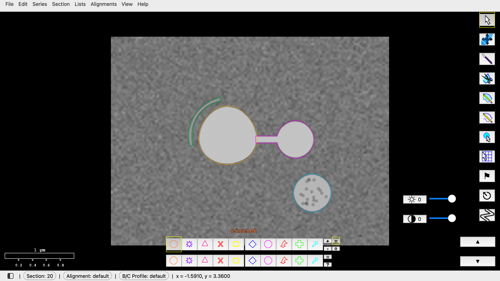{ data-width="1280" data-height="720" }

[▶ 16 s · loops](assets/videos/user-guide/11-add-to-scene.mp4){ .clip-src }

<figcaption markdown>**Lists ▸ Object list**, click the first object, **Shift**-click the last, right-click the selection, then **3D ▸ Add to scene**. The series is a made-up one: d01 a dendrite, d01sp01 its spine, ax01 an axon, ast01 astroglia.</figcaption>
</figure>

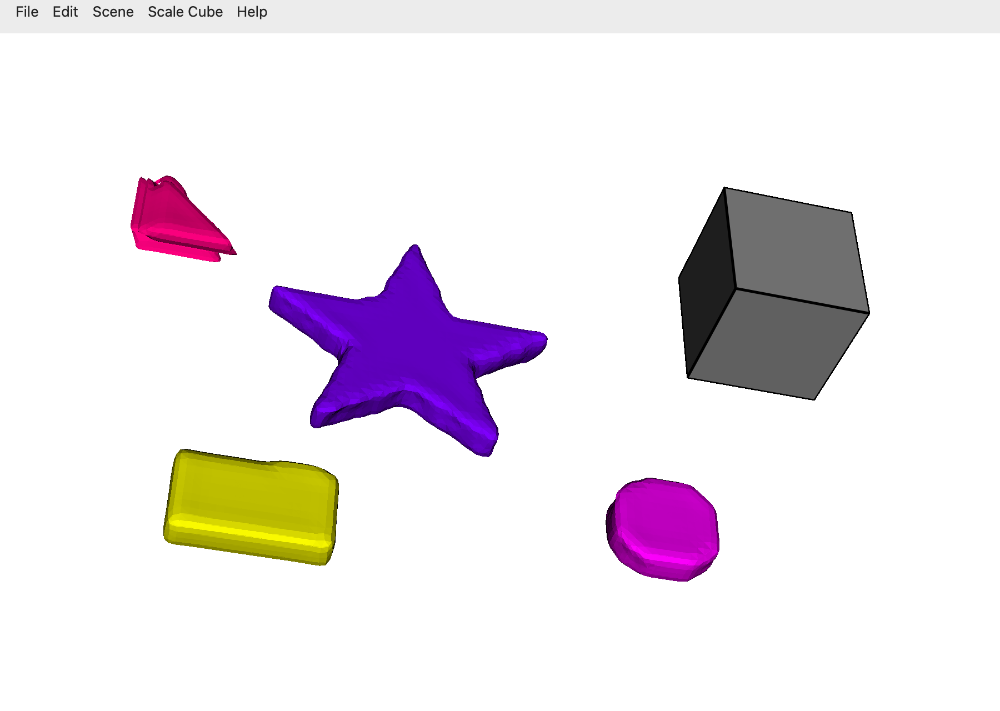

### 3D model types

Each object has a **3D type** (set in **Edit 3D settings…** from the object list):

- **Surface** (default): a smoothed surface reconstructed from the object's traces
  (negative traces are subtracted, e.g. to hollow out a structure).
- **Spheres**: one sphere per trace, sized to the trace's radius (good for
  point-like or stamped objects).
- **Contours**: each trace rendered as a thin slab, showing the raw cross-sections.

Z-traces render as tubes. **Edit 3D settings…** also sets per-object **opacity**.

Series-wide 3D quality is controlled in **Series ▸ Options** (the 3D section): an
**XY Resolution** slider (less detail/faster ↔ more detail/slower), the **3D
smoothing** method (Humphrey is recommended; the others are Mutable Diffusion
Laplacian, Taubin, and None), the **smoothing iterations**, and the **screenshot
resolution (dpi)**.

### Navigating the 3D scene

- **Left-drag** rotates; **middle-drag** pans; **right-drag** zooms. (`Ctrl`-drag
  also rotates.)
- **Double-click** an object to jump the 2D field to that point on the corresponding
  section.
- Click meshes to select them. With objects selected: arrow keys translate in X/Y,
  `Ctrl`+Up/Down translates in Z, `Shift`+arrows and `Ctrl+Shift`+Up/Down rotate.
  `Delete`/`Backspace` removes selected objects from the scene; `[` / `]` step their
  opacity.
- Set the camera along an axis with **X** / **Y** / **Z**, fit everything with
  **Home** ("Focus on all"), and center on the selection with **F**.
- Press **`?`** in the scene for its full shortcut list.

The 3D window has its own menu bar:

- **Scale cube**: toggle a reference cube with the **C** key (or **Scale Cube ▸
  Display in scene**). To move it, select it (left-click) and use the arrow keys
  (X/Y) and `Ctrl`+Up/Down (Z). Edit its **edge length (µm)**, color, opacity, and
  outline width via **Edit ▸ Edit attributes…** (`Ctrl+E`). It's a physical
  measuring reference.
- **Scene ▸ Change background** sets the background color.
- **Scene ▸ Organize scene…** (`Ctrl+Shift+H`) lines objects up side by side, by
  host group or individually.
- **Scene ▸ Set translate/rotate step…** sets the movement increments (default
  0.1 µm and 10°).
- **File ▸ Save scene… / Load scene…** save the scene (objects, colors, camera) to
  a JSON file and reload it later (also **Series ▸ 3D ▸ Load 3D scene…** from the
  main window). **Add to scene** can also pull objects from another series.

### Saving images and exporting meshes

- **Scene ▸ Save scene screenshot…** saves a rendered image (PNG, JPG, TIF, or BMP)
  at the configured DPI.
- **Scene ▸ Export scene…** exports the whole scene as a single Wavefront `.obj`
  (with a `.mtl` material file).
- From the **Object list ▸ 3D ▸ Export mesh as**, export individual objects as
  **Wavefront (.obj)**, **OFF (.off)**, **Stanford PLY (.ply)**, **STL (.stl)**, or
  **Collada (.dae)**. (Surface and Spheres objects export; contour and tube types do
  not. Collada export additionally requires the optional `pycollada` package; if it
  is missing you'll be told, rather than seeing an error.)
- **Object list ▸ 3D ▸ Export quantitative data** writes per-object surface area
  and volume to CSV. (Note these depend on the meshing settings; verify mesh quality
  before relying on the numbers.)

---

## 12. Saving and backups

### Saving

**File ▸ Save** (`Ctrl+S`) writes the series back to its `.jser`. **File ▸ Save
as…** writes a copy to a new location. PyReconstruct does **not** auto-save on a
timer, so save regularly. (If you close with unsaved changes, you are prompted to
save. If a session ends uncleanly, reopening offers to recover it; see
[Opening and creating a series](#4-opening-and-creating-a-series).)

### Backups

A backup is a complete copy of the series saved as an ordinary `.jser` into a
folder you choose, with a filename you configure. There are two ways to make one:

- **File ▸ Backup ▸ Backup now…** (`Ctrl+Shift+B`) saves the current data and writes
  a backup, optionally with a comment appended to the filename.
- **Automatic backups**: enable **Auto-backup (create backup on every save)** in
  the backup settings, and a backup is written every time you Save or Save As.

**File ▸ Backup ▸ Settings…** configures the **Backup Folder** and the filename
template. The template is assembled from optional parts joined by a delimiter: a
prefix, the series code, the series name, the date and time (with customizable
strftime patterns), the username, and a suffix. A live preview shows the
resulting filename, and
name collisions get a numeric suffix (`-01`, `-02`, …). The folder and the
auto-backup toggle are remembered **per series**; the naming template is shared
across all series. (The backup folder and naming are also available under **Series ▸
Options ▸ Backup**.)

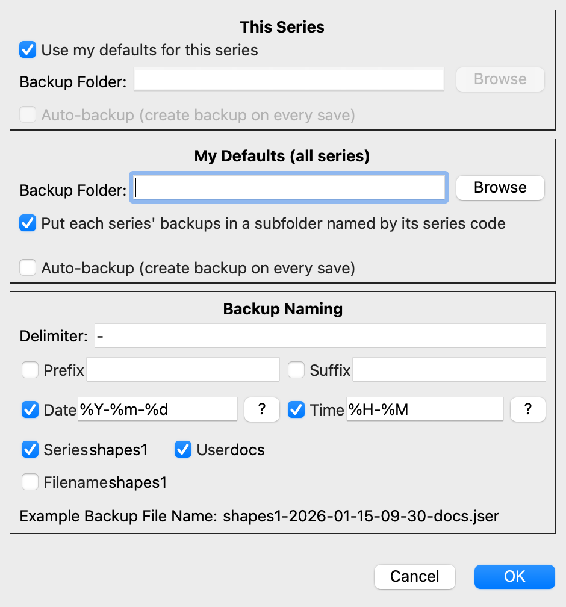

Because backups are just `.jser` files, **restore a backup by opening it** with
**File ▸ Open series…**. If the configured backup folder is missing at save time (for
example a disconnected network drive), PyReconstruct prompts you to set it, or
disables auto-backup until you do.

> **Tip.** Keep your backup folder on separate storage from your working `.jser`,
> and turn on auto-backup for active projects.

---

## 13. Keyboard shortcuts

These are the defaults, in the groups and words of **Help ▸ Shortcuts list** (`?`),
where you can rebind them. A key with `Cmd` or `Option` is written for macOS first;
on Windows and Linux it is `Ctrl` or `Alt`, shown after it.

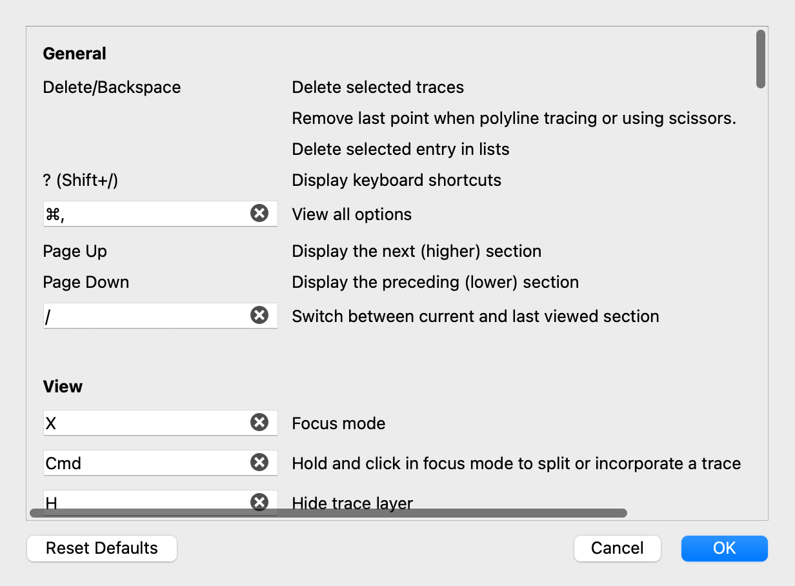

<!-- generated: shortcuts (from PyReconstruct's source; to update, run: python3 scripts/docs_tables.py --write) -->
### General

| Key | Action |
|---|---|
| `Delete/Backspace` | Delete selected traces. Remove last point when polyline tracing or using scissors. Delete selected entry in lists. |
| `? (Shift+/)` | Display keyboard shortcuts |
| `Cmd+,` (`Ctrl+,` on Windows/Linux) | View all options |
| `Page Up` | Display the next (higher) section |
| `Page Down` | Display the preceding (lower) section |
| `/` | Switch between current and last viewed section |

### View

| Key | Action |
|---|---|
| `X` | Focus mode |
| `Cmd` (`Ctrl` on Windows/Linux) | Hold and click in focus mode to split or incorporate a trace |
| `H` | Hide trace layer |
| `A` | Show all traces (ignore hidden) |
| `I` | Hide image |
| `-` | Decrease brightness |
| `=` | Increase brightness |
| `[` | Decrease contrast |
| `]` | Increase contrast |
| `Space` | Section blend |
| `Home` | Set view to image |

### Field Interactions

| Key | Action |
|---|---|
| `Cmd+A` (`Ctrl+A` on Windows/Linux) | Select all traces on section, or all rows in a focused data list |
| `Cmd+D` (`Ctrl+D` on Windows/Linux) | Deselect all traces on section, or all rows in a focused data list |
| `Cmd+Shift+I` (`Ctrl+Shift+I` on Windows/Linux) | Invert which traces are selected on section, or which rows in a focused data list |
| `Cmd+E` (`Ctrl+E` on Windows/Linux) | Edit attributes of selected trace(s) |
| `Cmd+Shift+R` (`Ctrl+Shift+R` on Windows/Linux) | Smooth selection (traces, or objects over the object list) |
| `Shift+M` | Merge selected traces |
| `Cmd+Shift+M` (`Ctrl+Shift+M` on Windows/Linux) | Merge attributes of selected traces |
| `Shift+H` | Hide selected traces |
| `Cmd+U` (`Ctrl+U` on Windows/Linux) | Unhide all hidden traces on current section |
| `Shift+G` | Modify current palette button to match attributes of first selected trace |
| `Cmd+Shift+G` (`Ctrl+Shift+G` on Windows/Linux) | Modify current palette button to match attributes and shape of first selected trace |
| `Cmd+Shift+U` (`Ctrl+Shift+U` on Windows/Linux) | Unlock current section |
| `Cmd+T` (`Ctrl+T` on Windows/Linux) | Modify transform on current section |
| `Cmd+\` (`Ctrl+\` on Windows/Linux) | Align by correlation |
| `Cmd+Shift+H` (`Ctrl+Shift+H` on Windows/Linux) | Set host(s) for selected trace(s) |

### Edit

| Key | Action |
|---|---|
| `Cmd+Z` (`Ctrl+Z` on Windows/Linux) | Undo |
| `Cmd+Y` (`Ctrl+Y` on Windows/Linux) | Redo |
| `Cmd+C` (`Ctrl+C` on Windows/Linux) | Copy selected traces to clipboard |
| `Cmd+Option+C` (`Ctrl+Alt+C` on Windows/Linux) | Copy selected traces onto other sections |
| `Cmd+Option+X` (`Ctrl+Alt+X` on Windows/Linux) | Delete selected trace name(s) from chosen sections |
| `Cmd+Shift+D` (`Ctrl+Shift+D` on Windows/Linux) | Add selected object(s) to the 3D scene |
| `Cmd+X` (`Ctrl+X` on Windows/Linux) | Cut selected traces to clipboard |
| `Cmd+V` (`Ctrl+V` on Windows/Linux) | Paste clipboard traces into section |
| `Cmd+Shift+V` (`Ctrl+Shift+V` on Windows/Linux) | Apply attributes of copied traces to selected trace(s) |

### Navigate

| Key | Action |
|---|---|
| `Cmd+F` (`Ctrl+F` on Windows/Linux) | Find first instance of a trace in the series |
| `Shift+F` | Find a trace on the current section |
| `Cmd+G` (`Ctrl+G` on Windows/Linux) | Go to a specific section number |
| `Cmd+K` (`Ctrl+K` on Windows/Linux) | Search the menus for a command |

### File

| Key | Action |
|---|---|
| `Cmd+O` (`Ctrl+O` on Windows/Linux) | Open a series file |
| `Cmd+S` (`Ctrl+S` on Windows/Linux) | Save |
| `Cmd+Shift+B` (`Ctrl+Shift+B` on Windows/Linux) | Backup series |
| `Cmd+N` (`Ctrl+N` on Windows/Linux) | New series |
| `Cmd+Option+R` (`Ctrl+Alt+R` on Windows/Linux) | Restart |
| `Cmd+Q` (`Ctrl+Q` on Windows/Linux) | Quit |

### Lists

| Key | Action |
|---|---|
| `Cmd+Option+S` (`Ctrl+Alt+S` on Windows/Linux) | Show or hide the lists |
| `Cmd+Shift+O` (`Ctrl+Shift+O` on Windows/Linux) | Open Object List |
| `Cmd+Shift+C` (`Ctrl+Shift+C` on Windows/Linux) | Toggle curation columns in object list |
| `Cmd+Shift+T` (`Ctrl+Shift+T` on Windows/Linux) | Open Trace List |
| `Cmd+Option+Z` (`Ctrl+Alt+Z` on Windows/Linux) | Open Z-trace List |
| `Cmd+Shift+S` (`Ctrl+Shift+S` on Windows/Linux) | Open Section List |
| `Cmd+Shift+F` (`Ctrl+Shift+F` on Windows/Linux) | Open Flag List |
| `Cmd+Shift+A` (`Ctrl+Shift+A` on Windows/Linux) | Switch/modify alignments |

### Trace Palette

| Key | Action |
|---|---|
| `#, Shift+#` | Select a trace on the palette |
| `Cmd+#, Cmd+Shift+#` (`Ctrl+#, Ctrl+Shift+#` on Windows/Linux) | Edit attributes of a single trace on the palette |
| `Cmd+Shift+P` (`Ctrl+Shift+P` on Windows/Linux) | Switch/modify palettes |
| `Cmd+]` (`Ctrl+]` on Windows/Linux) | Increment palette {#} up |
| `Cmd+[` (`Ctrl+[` on Windows/Linux) | Increment palette {#} down |

### Movements

| Key | Action |
|---|---|
| `Left/Right/Up/Down` | Translate selected traces or image (when no trace selected) |
| `Cmd+Left/Right/Up/Down` (`Ctrl+Left/Right/Up/Down` on Windows/Linux) | Translate traces or image by small step |
| `Shift+Left/Right/Up/Down` | Translate trace or image by large step |
| `Cmd+Shift+Left/Right/Up/Down` (`Ctrl+Shift+Left/Right/Up/Down` on Windows/Linux) | Rotate image around the mouse |
| `F1, Shift+F1, F2, Shift+F2` | Scale image in X and Y |
| `F3, Shift+F3, F4, Shift+F4` | Shear image in X and Y |

### Tool Palette

| Key | Action |
|---|---|
| `P` | Use pointer tool |
| `Z` | Use pan/zoom tool |
| `K` | Use knife tool |
| `Shift+K` | Use scissors tool |
| `C` | Use closed trace tool |
| `O` | Use open trace tool |
| `S` | Use stamp tool |
| `G` | Use grid tool |
| `F` | Use flag tool |
| `Q` | Use host tool |

### 3D Scene

| Key | Action |
|---|---|
| `? (Shift+/)` | Display shortcuts in 3D scene |
<!-- /generated: shortcuts -->

---

## 14. Getting help

In the app, **Help ▸ Online resources** links to:

- the [PyReconstruct user guide](https://wikis.utexas.edu/display/khlab/PyReconstruct+user+guide)
  on the UT Austin lab wiki,
- this distribution's [source code](https://github.com/dustenhubbard/PyReconstruct),
- the [Kristen Harris Lab website](https://synapseweb.clm.utexas.edu/harrislab) and
  the [Atlas of Ultrastructural Neurocytology](https://synapseweb.clm.utexas.edu/atlas).

Found a bug, have a feature idea, or want to improve the docs? Please open an issue
on this distribution's
**[GitHub Issues](https://github.com/dustenhubbard/PyReconstruct/issues)**. The
in-app **Help ▸ Report a bug...** and **Help ▸ Request a feature...** items open the
same place with your version and OS already filled in. If you file another way,
**Help ▸ Copy diagnostic report** gathers that in one paste, or click the
version/commit shown at the top of the **Help** menu to copy the commit to your
clipboard. **Help ▸ Email developers** writes to the same team.

---

## Credits

PyReconstruct was created by Michael A. Chirillo, Julian N. Falco, Michael D.
Musslewhite, Larry F. Lindsey, and Kristen M. Harris (Kristen Harris Lab,
Department of Neuroscience, Center for Learning and Memory, **The University of
Texas at Austin**) and introduced in *PNAS* (2025). The upstream project lives at
[SynapseWeb/PyReconstruct](https://github.com/SynapseWeb/PyReconstruct); it succeeds
the original **Reconstruct** by John C. Fiala.

This distribution is independently developed and maintained by **Dusten Hubbard**
(Kristen Harris Lab, **The University of Texas at Austin**). See the
[README](https://github.com/dustenhubbard/PyReconstruct/blob/main/README.md) for provenance, performance notes, and citation details, and
[CONTRIBUTING.md](https://github.com/dustenhubbard/PyReconstruct/blob/main/CONTRIBUTING.md) to help improve PyReconstruct.
