# Lab 1.2: The Postsynaptic Density

NEU466G, Dr. Kirk · [Class documents](index.md)
{ .class-doc-meta }

## Overview

Synapses can be identified by the presence of a darkly stained postsynaptic density (PSD) in the dendritic spine with small synaptic vesicles in the presynaptic axon directly opposing it. In the electron microscope image below, the red arrows are pointing at the PSDs in dendritic spine heads; vesicles are visible in the opposing presynaptic axon.

<figure class="class-fig" markdown="span">
  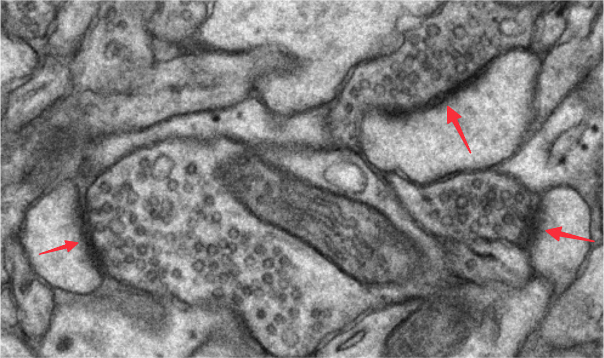{ width="625" }
  <figcaption>Red arrows point at PSDs in dendritic spine heads.</figcaption>
</figure>

This lab will build on the work you did tracing spines from Lab 1.1 by adding the synapses to your fully reconstructed spines. A trace of the PSD area supplies the area of the synapse. Here are the names of the traces you will be adding and their colors:

| Spines (List Objects, Filter by Group, Module 1) | Synapse quantification (cfa = contact flat area) | Synapse visualization (c = contact) |
| --- | --- | --- |
| d03sp06 | d03cfa06 | d03c06 |
| d03sp32 | d03cfa32 | d03c32 |
| d03sp47 (branch a) | d03cfa47a | d03c47a |
| d03sp47 (branch b) | d03cfa47b | d03c47b |

Before we detail how to do this using the tools in PyReconstruct, we will review the three types of PSD orientation in 3D and how this impacts their 2D projection for a single EM section. This will highlight how the same object can look different in 2D depending on the cutting plane. The PSDs you will be tracing in Lab 1.2 are all cross section PSDs. These are the most simple and straightforward to trace and grasp how the synapse size is calculated.

## Three types of PSD orientation

In the following cartoons, the dashed lines indicate a single section (sections are typically around 50 nm; these drawings are not to scale). The cartoons indicate how, depending on the orientation of the spine with respect to the shaft, a synapse can be sectioned in different orientations. (Cartoons by P.H. Parker.)

### 1. Cross section

Cross section PSDs occur when the section is cut perpendicular to the synapse. Sometimes you can clearly see the synaptic cleft between the spine and axon membranes. Right, EM image of spine (S) with perfectly cross-sectioned synapse ([SynapseWeb Atlas, 1.6.04](https://synapseweb.clm.utexas.edu/atlas/1-neuron/16-chemical-synapses/1604)).

<figure class="class-fig" markdown="span">
  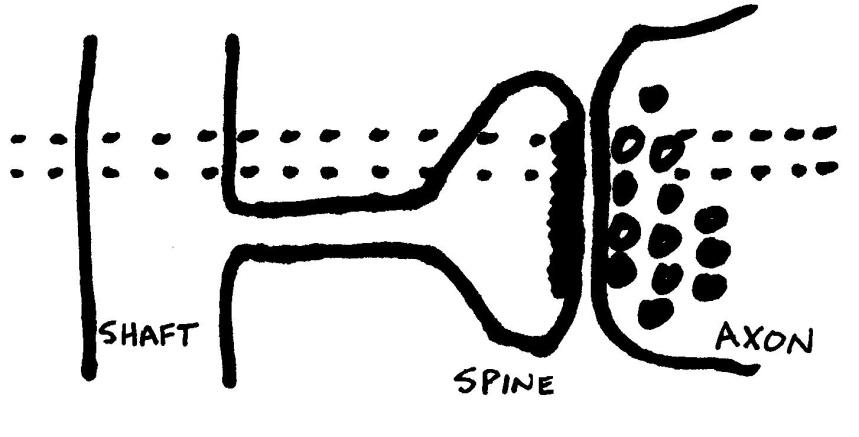{ width="430" }
  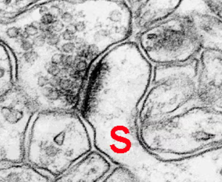{ width="224" }
  <figcaption>Cross section. Cartoon by P.H. Parker; EM from the SynapseWeb Atlas.</figcaption>
</figure>

### 2. Oblique

Oblique PSDs occur when the section is cut at an angle to the synapse such that the PSD "slopes" across more than one section. The PSD will appear as a larger smear and you will not see the extracellular space in the synaptic cleft.

<figure class="class-fig" markdown="span">
  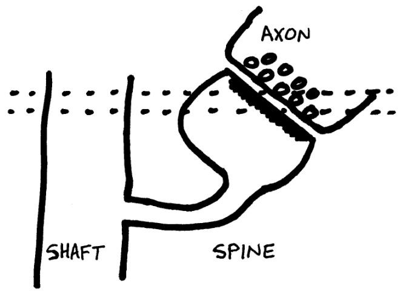{ width="430" }
  <figcaption>Oblique. Cartoon by P.H. Parker.</figcaption>
</figure>

### 3. En face

En face PSDs occur when the section is cut parallel to the synapse, so that the entire "face" of the synapse is visible in one section. Note that the entire PSD is contained in the section. En face is a French phrase meaning "facing forward" or "in front".

<figure class="class-fig" markdown="span">
  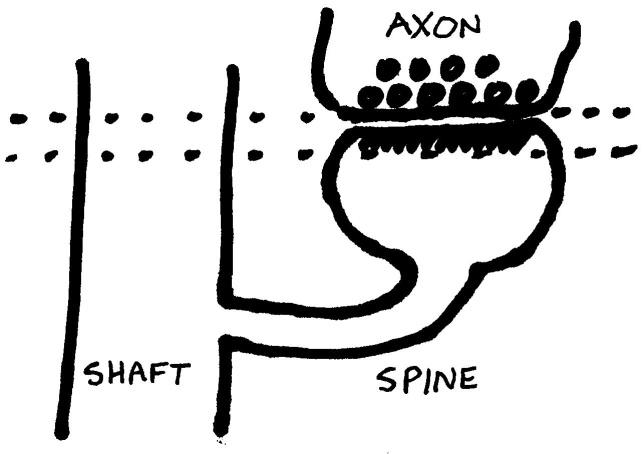{ width="430" }
  <figcaption>En face. Cartoon by P.H. Parker.</figcaption>
</figure>

## Two types of tracing tools

The two basic types of tracing tools in PyReconstruct are closed and open. Both open and closed traces will be needed to trace synapses.

| Tracing tool | Purpose | Flat area calculation | Tools icon |
| --- | --- | --- | --- |
| Closed Trace | Closed traces (like circles) | Area of the closed trace | 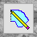{ .class-icon } |
| Open Trace | Open traces (like lines) | Length times section thickness | 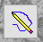{ .class-icon } |

## Two types of PSD traces: contact vs contact flat area

In this context the word "**Contact**" refers to synaptic contact.

**Contact traces (c-traces; red):** creates a 3D reconstruction of the PSD.

**Contact flat area traces (cfa-traces):** quantifies the synaptic area.

| Trace name | Purpose | Color | Tools icon |
| --- | --- | --- | --- |
| d##c## | 3D visualization in PyReconstruct | red | { .class-icon } |
| d##cfa## | Synapse area calculation | green | { .class-icon } |

To create these, right click a trace palette square and edit the name and color:

<figure class="class-fig" markdown="span">
  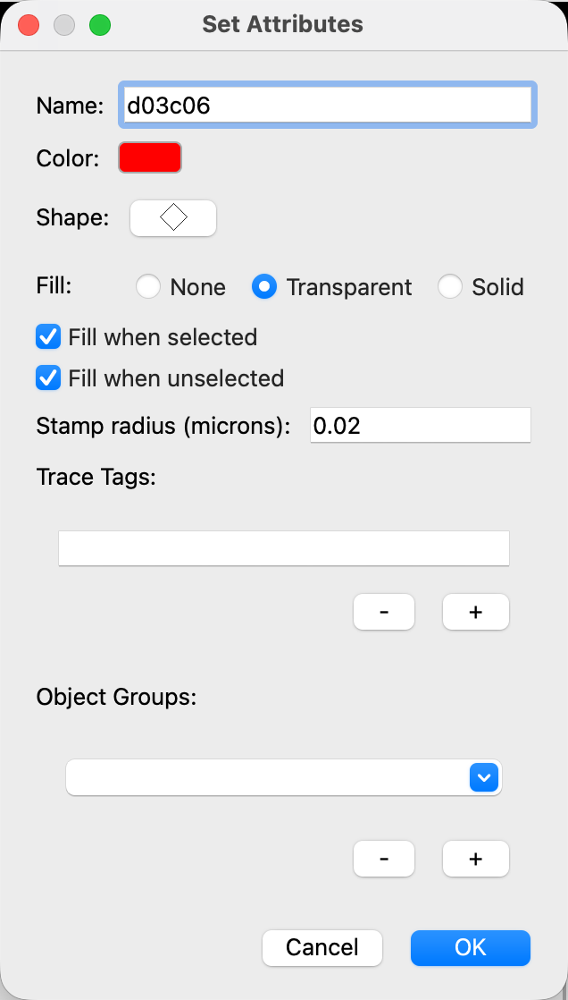{ width="318" }
  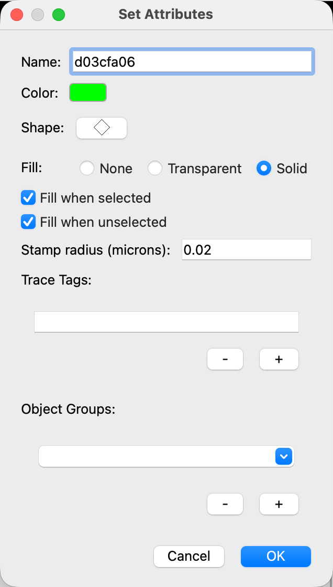{ width="318" }
  <figcaption>Set Attributes for d03c06 (left) and d03cfa06 (right).</figcaption>
</figure>

## Tracing PSDs: cross-sectioned

(Example from series CLZBJ d04p03.)

Serial section EM images of spine trace (yellow), c-trace to create 3D reconstruction (red), and cfa-trace for synapse flat area quantification (green).

**Section 1:** No PSD.

<figure class="class-fig" markdown="span">
  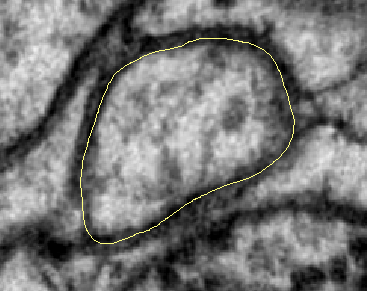
  <figcaption>Section 1.</figcaption>
</figure>

**Section 2:** The PSD is traced with an open cfa-trace line (green) along the length of the PSD. The cfa-trace is encapsulated by a closed c-trace (red) extending outside of the spine membrane and protruding slightly into the axon.

<figure class="class-fig" markdown="span">
  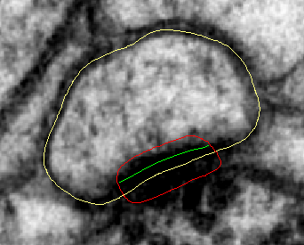
  <figcaption>Section 2.</figcaption>
</figure>

**Sections 3, 4:** Traced as above on each section.

<figure class="class-fig" markdown="span">
  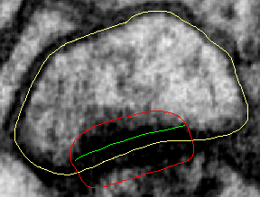
  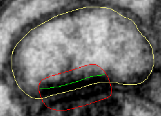
  <figcaption>Sections 3 and 4.</figcaption>
</figure>

**Section 5:** The PSD is no longer present/visible, so no traces are added.

<figure class="class-fig" markdown="span">
  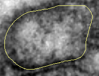
  <figcaption>Section 5.</figcaption>
</figure>

## Calculating flat area of synapses

1. Filter your object list for d03 synapses (**Lists > Object list** (Ctrl+Shift+O) > **Filter > Regex filter...** > replace the .\* with d03cfa.\* > OK).
2. You should see the flat areas listed for your synapses. The unit of measurement is square microns (µm²). Be sure you're looking at the flat area, not volume. (If you don't see Flat Area listed, go to the menu bar in the Object List window > **Columns > Set columns...** > make sure Flat area is checked > Click OK.) Here is a screen cap from the Object List:

    <figure class="class-fig" markdown="span">
      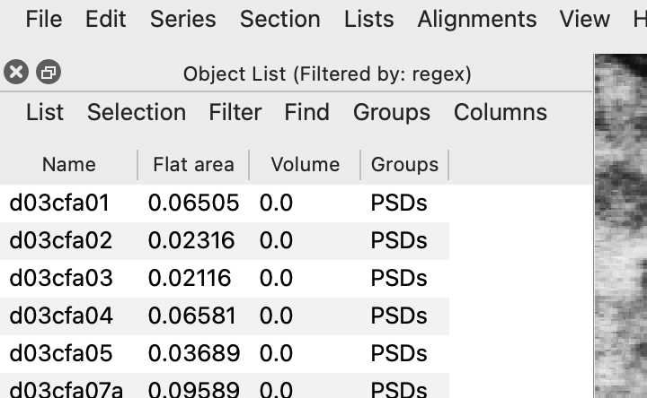{ width="360" }
      <figcaption>The Object List filtered by d03cfa.\*</figcaption>
    </figure>

3. You can export your Object List by selecting **List > Export** > choose a name for the file > save. It will save it as a Comma separated file (.csv) that you can open with Excel. You can also select the listed flat area values in the Object List and Ctrl+C to copy the values and paste into a spreadsheet.
4. For a cross sectioned synapse, flat area is calculated by multiplying the length of the cfa-trace by the section thickness. Flat area = Σall sections [Σopen traces length × thickness + Σclosed traces area]

## References

- [Legacy Reconstruct User Manual](http://synapseweb.clm.utexas.edu/sites/default/files/synapseweb/files/reconstructusermanualv1.1.0.0.pdf), Chapter 9, p. 106.
- [SynapseWeb Atlas, 1.6.04](https://synapseweb.clm.utexas.edu/atlas/1-neuron/16-chemical-synapses/1604).
