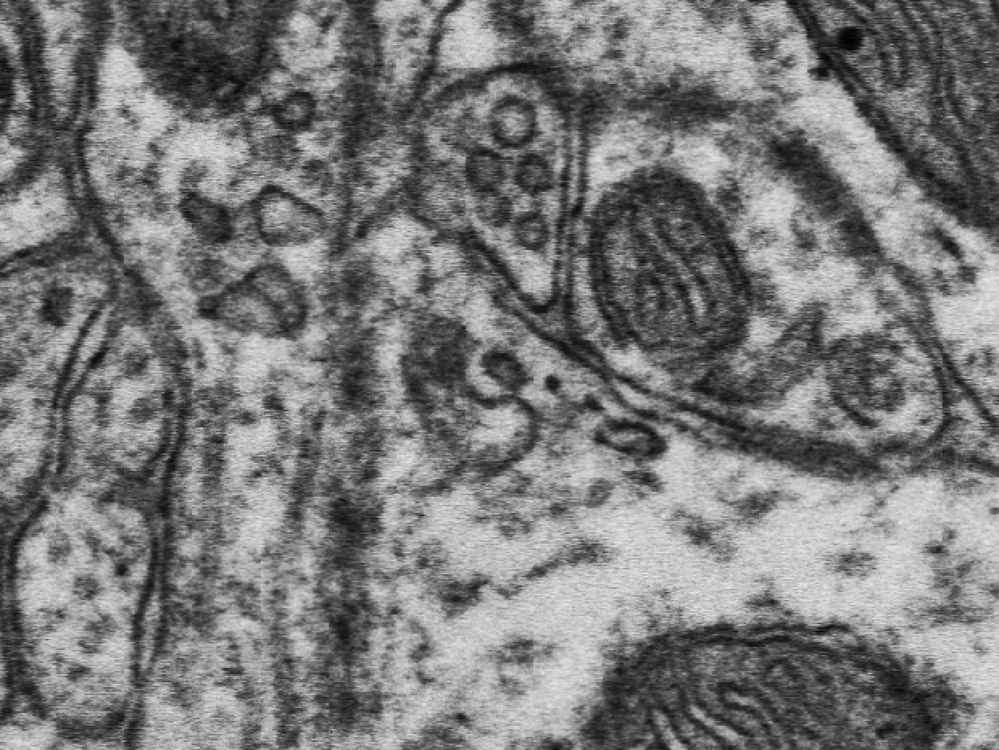
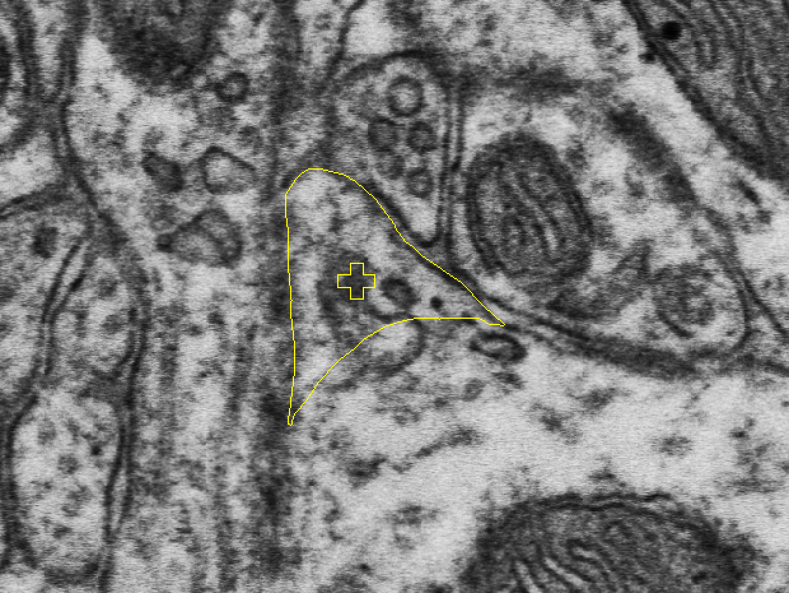
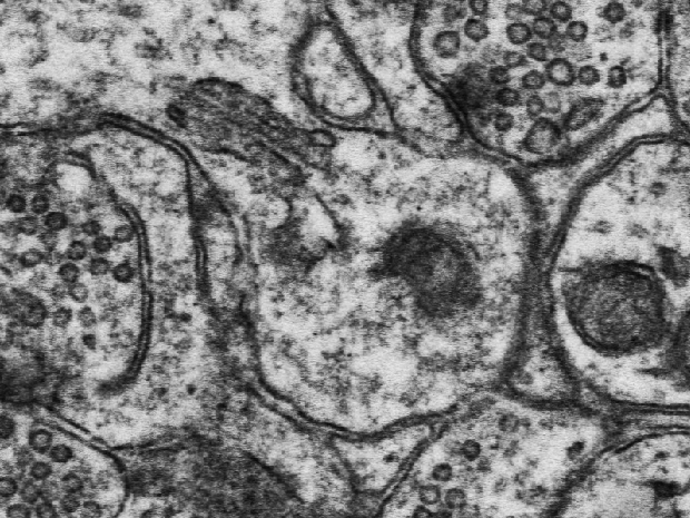
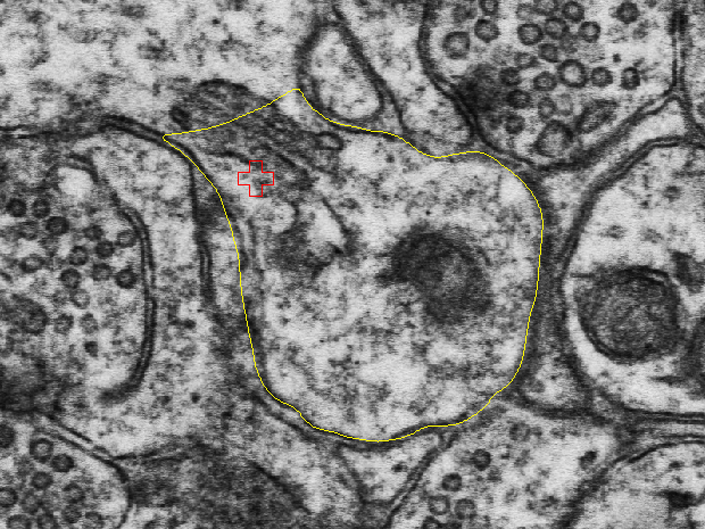
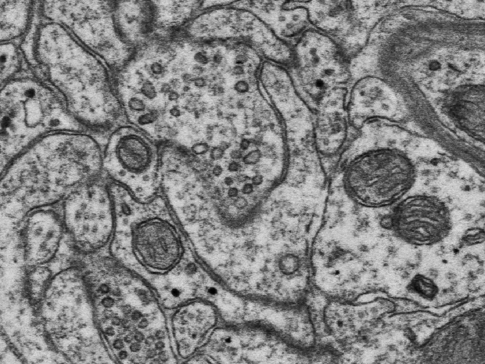
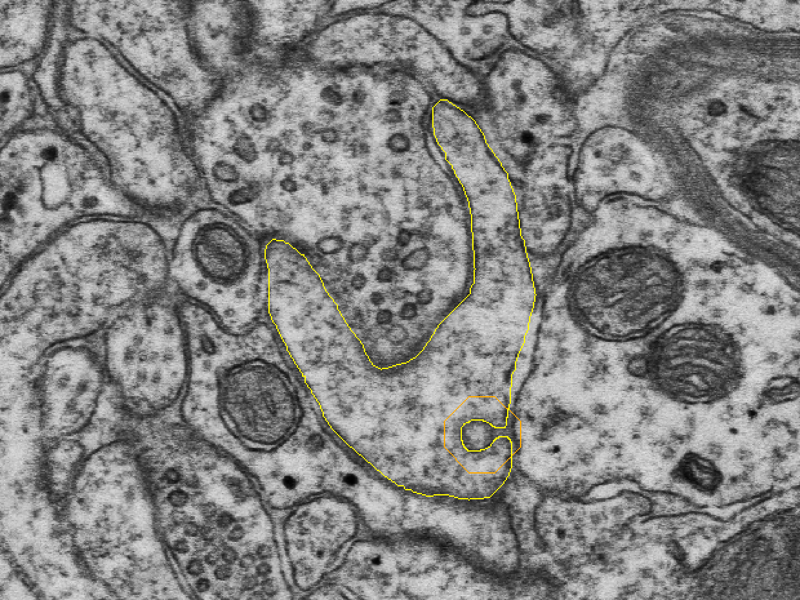
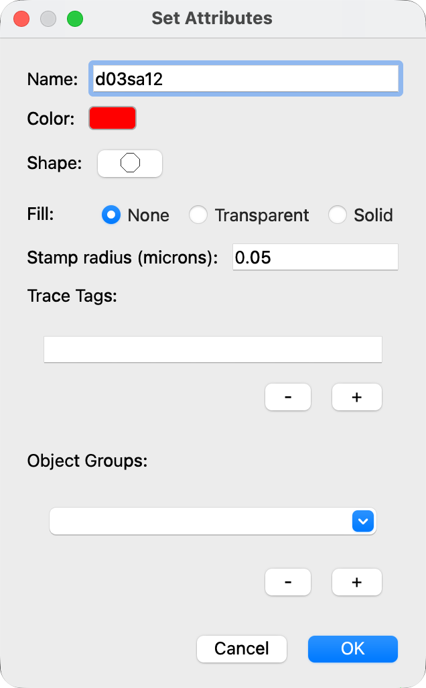
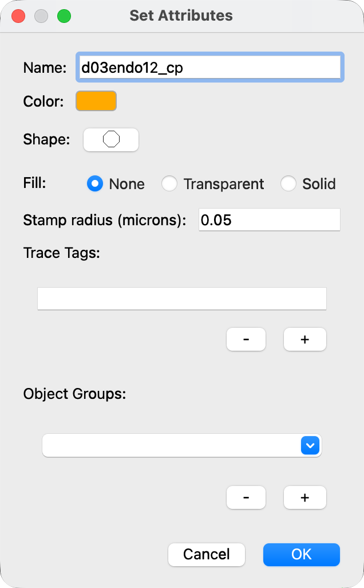
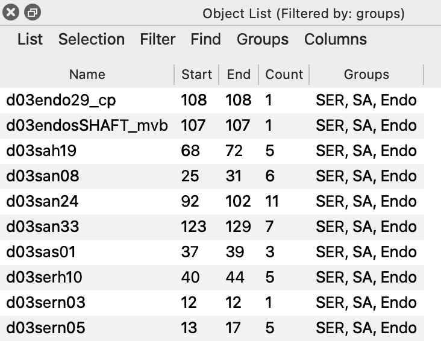

# Lab 3.1: Smooth Endoplasmic Reticulum, Spine Apparatus, and Endosomes

NEU466G, Dr. Kirk · [Class documents](index.md)
{ .class-doc-meta }

## Overview

In this lab you look for smooth endoplasmic reticulum (SER), spine apparatus (SA), and endosomes in 5 additional spines, and stamp each one you find. Each Figure box links a journal figure from the papers listed under [References](#references); open them while you work. The EM screenshots on this page show examples from other spines of the series, not from your 5 assigned spines.

## Smooth endoplasmic reticulum (SER)

- **SER** has a flattened, oval appearance surrounded by a membrane, but this **shape can be variable** (e.g., on one section the SER can look like a gray smudge, a small black dot, a snake-like black line, or a large vesicle-like lake).
- **SER is connected across serial sections** (though sometimes this continuity can be difficult to see).

!!! example "Figure: snake-like tubule of SER entering a spine"
    Spacek & Harris, 1997, Fig. 2c. [Open the paper](https://doi.org/10.1523/JNEUROSCI.17-01-00190.1997).

<figure class="class-fig" markdown="span">
  { width="350" }
  { width="350" }
  <figcaption>SER in spine d03sp05 on section 15, without traces (left) and with d03sp05 and the SER stamp d03sern05 (right). The view is about 1.3 µm across.</figcaption>
</figure>

## Spine apparatus (SA)

- The spine apparatus is a specialized derivative of the SER.
- SA is typically seen in large mushroom spines but can also appear in the dendritic shaft.
- SA appears as flat cisternae (arrows) with electron-dense plates between them (wavy arrows); see the figure below.

!!! example "Figure: spine apparatus, with cisternae (arrows) and dense plates (wavy arrows)"
    Spacek & Harris, 1997, Fig. 3b. [Open the paper](https://doi.org/10.1523/JNEUROSCI.17-01-00190.1997).

<figure class="class-fig" markdown="span">
  { width="350" }
  { width="350" }
  <figcaption>SA in the head of spine d03sp19 on section 70, without traces (left) and with d03sp19 and the SA stamp d03sah19 (right). The view is about 1.6 µm across.</figcaption>
</figure>

## Endosomes

Endosomes are intracellular sorting organelles that are involved with the local recycling, sorting, and degradation of membrane and proteins.

Four major subtypes:

- Multivesicular body
- Tubule
- Smooth vesicle
- Coated vesicle or pit

!!! example "Figure: drawing of endosome types in three spines"
    Cooney et al., 2002. [Open the paper](https://doi.org/10.1523/JNEUROSCI.22-06-02215.2002).

### Endosome criteria

#### 1. Coated vesicles/pits

- Vesicles: Elliptical with gray interior and clathrin coat (cytoplasmic coat consisting of spoke-like protrusions).
- Pits: Elliptical, omega-shaped invaginations with gray interiors and clathrin coat.

!!! example "Figure: clathrin-coated pit, with an inset of a clathrin-coated vesicle"
    Cooney et al., 2002. [Open the paper](https://doi.org/10.1523/JNEUROSCI.22-06-02215.2002).

<figure class="class-fig" markdown="span">
  { width="350" }
  { width="350" }
  <figcaption>A coated pit on spine d03sp29 on section 108, without traces (left) and with d03sp29 and the stamp d03endo29_cp (right). The view is about 2.3 µm across.</figcaption>
</figure>

#### 2. Endosomal tubule

- Cylindrical compartment with smooth outer membrane + dark, grainy interior.
- Uniform diameter.
- May have a clathrin-like protein coat on the end (indicating vesicle budding).

!!! example "Figure: endosomal tubule"
    Cooney et al., 2002. [Open the paper](https://doi.org/10.1523/JNEUROSCI.22-06-02215.2002).

#### 3. Multivesicular body (MVB)

- Dark, grainy interior with variable number of internal vesicles.

!!! example "Figure: multivesicular body"
    Cooney et al., 2002. [Open the paper](https://doi.org/10.1523/JNEUROSCI.22-06-02215.2002).

#### 4. Vesicles (small/large/amorphous)

- Small/large smooth vesicles: light gray interiors with smooth outer membrane.
- Amorphous vesicles: smooth membranes, electron-lucent interiors, and irregular shapes. Often occur in clumps.

!!! example "Figure: small and large smooth vesicles, and a clump of amorphous vesicles"
    Cooney et al., 2002. [Open the paper](https://doi.org/10.1523/JNEUROSCI.22-06-02215.2002).

## 5 additional spines

To learn to identify these spine resources, you are assigned **5** additional spines:

- **d03p12**
- **d03p14**
- **d03p37_branched**
- **d03p40**
- **d03p42**

You will search in these spines for SER, SA, and endosomes. These spines have already been fully traced for you (including their c/cfa-traces).

## Stamp spine SER and SA

Identify and stamp SER or SA in each of these 5 spines.

Right-click the palette button to open Set Attributes, set Stamp radius (microns) to 0.05, and set the name to **d03sa## for SA** and **d03ser## for SER**, with ## corresponding to the spine ##, e.g., SA found in d03p12 would be named d03sa12. For each of the 5 additional spines listed above, stamp any SER and SA you observe within the spine head and spine neck.

Each of the 5 assigned spines will have either SER or SA.

<figure class="class-fig" markdown="span">
  { width="318" }
  <figcaption>Set Attributes for d03sa12.</figcaption>
</figure>

## Stamp spine endosomes

Look for endosomes in each of these 5 spines.

In spines in which endosomes have been identified, place a stamp on the endosomal object.

!!! tip "Hint"
    You are likely to find a coated pit in these 5 spines. There may be additional endosomal structures that need a second stamp in these spines.

Right-click the palette button to open Set Attributes, set Stamp radius (microns) to 0.05, and set the name to **d03endo##_cp** (with cp for coated pit and ## corresponding to spine ##). All but one of these spines has at least one endosome.

<figure class="class-fig" markdown="span">
  { width="318" }
  <figcaption>Set Attributes for d03endo12_cp.</figcaption>
</figure>

<figure class="class-fig" markdown="span">
  { width="366" }
  <figcaption>The Object List filtered by the group "SER, SA, Endo", with the first and last section of each stamp.</figcaption>
</figure>

!!! note "Extra credit"
    +0.25 pts extra credit on your lab report if you can correctly identify all coated pits in your spines.

## References

- Spacek J, Harris KM (1997). Three-dimensional organization of smooth endoplasmic reticulum in hippocampal CA1 dendrites and dendritic spines of the immature and mature rat. *Journal of Neuroscience* 17(1):190-203. [doi:10.1523/JNEUROSCI.17-01-00190.1997](https://doi.org/10.1523/JNEUROSCI.17-01-00190.1997)
- Cooney et al. (2002). *Journal of Neuroscience* 22(6):2215-2224. [doi:10.1523/JNEUROSCI.22-06-02215.2002](https://doi.org/10.1523/JNEUROSCI.22-06-02215.2002)
