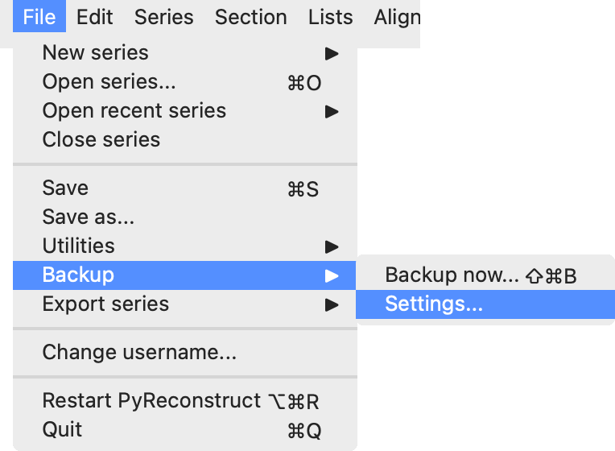
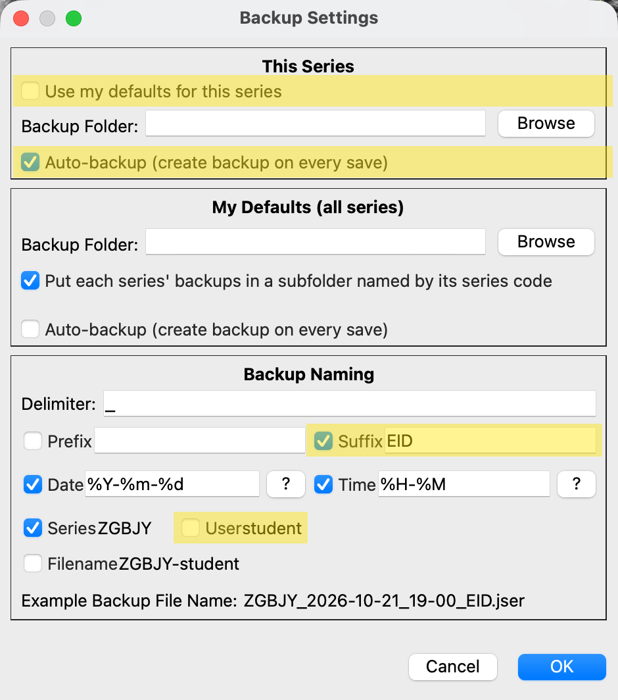

# Class Project, Part 1 (Week 7): Classifying Synapses

NEU466G, Dr. Kirk · [Class documents](index.md)
{ .class-doc-meta }

## Overview

Expected time: one class period, with a little of the next class if you need it.

Your first task on your dendrite is to classify every synapse as **perforated**, **horseshoe**, **segmented**, or **macular** (non-perforated), using the definitions in Nicholson et al. (2004), Fig. 1.

!!! example "Figure: synapse shapes"
    Nicholson et al., 2004, Fig. 1. [Open the paper](https://doi.org/10.1523/JNEUROSCI.1725-04.2004).

Have the paper open while you work; this guide covers only how to do it in PyReconstruct.

## About your data

- Your series contains your dendrite (yellow), its protrusion stamps (p), its synapses (c), and their contact flat areas (cfa). Do not delete or rename any of them.
- This is real data! Some of it has been curated, some of it has not. You may occasionally come across missing, misplaced, or wrong traces. If you see something weird, let us know and we'll take a look.
- Your series may have missing sections or section flaws.

## Before you start

- Copy both items for your dendrite to your computer and keep them in the same folder: the series file (XXXXX_d###.jser) and its image folder (XXXXX_d###_crop-zarr). Do not rename either one.
- Open the series in PyReconstruct. The first time, it will ask where the images are; select the _crop-zarr folder.
- **Set the backup settings to match the following.** Open **File > Backup > Settings...**. Under This Series, uncheck "Use my defaults for this series," click Browse to choose a Backup Folder, and check "Auto-backup (create backup on every save)." Under Backup Naming, uncheck User, check Suffix, and type your user ID in the Suffix box. Click OK.

<figure class="class-fig" markdown="span">
  { width="382" }
  <figcaption>File > Backup > Settings...</figcaption>
</figure>

<figure class="class-fig" markdown="span">
  { width="470" }
  <figcaption>Backup Settings. The yellow marks show the boxes to change. The Backup Folder is still blank here; click Browse to choose yours.</figcaption>
</figure>

## Steps

1. Open the Object List: **Lists > Object list** (Ctrl+Shift+O).
2. Show only the synapses: in the Object List, **Filter > Regex filter...** and enter `d\d{3}c\d.*`. This hides the cfa and p objects. You classify the c objects.
3. Right-click a synapse and choose **3D > Add to scene**. Rotate the 3D view until you are looking at the face of the synapse.
4. If the synapse looks macular in 3D, record it (step 6). If you suspect it is anything other than macular, go back to the EM images before deciding.
5. To check the EMs, select the synapse in the Object List and use **Find > Go to first contour** (or double-click it) to jump to its first section. The Start and End columns give its first and last sections. Step through every one of them.
6. Record your call: right-click the synapse and choose **Custom categories > Synapse_type**, then pick the type. The value appears in the Synapse_type column of the Object List.
7. Save often (Ctrl+S).

## Notes

- Synapses ending in A and B (for example d001c005A and d001c005B) are on branched spines. Classify each one separately.
- Some synapse names end with an axon ID (for example axe110 for axon-excitatory 110). You will still categorize these synapses, just ignore the axon ID.
- You do not need to categorize the inhibitory synapses. Inhibitory synapses will either have "_inhib" as a suffix on the synapse, or have **axi** in the name. Traced inhibitory synapses should appear blue instead of red.
- You are done when no synapse has a blank Synapse_type cell. To review one type at a time, use **Filter > Categorical column filters > Synapse_type** in the Object List.
- If you choose the wrong type, right-click and choose it again. Choose (blank) to clear it.

## References

- Nicholson DA, Yoshida R, Berry RW, Gallagher M, Geinisman Y (2004). Reduction in size of perforated postsynaptic densities in hippocampal axospinous synapses and age-related spatial learning impairments. *Journal of Neuroscience* 24(35):7648-7653. [doi:10.1523/JNEUROSCI.1725-04.2004](https://doi.org/10.1523/JNEUROSCI.1725-04.2004)
