# PyReconstruct Guide

NEU466G, Dr. Kirk · [Class documents](index.md)
{ .class-doc-meta }

## Overview

PyReconstruct is a modern update of Reconstruct, a program developed in the lab of Prof. Kristen Harris. PyReconstruct was developed by Harris Lab members Julian Falco and Michael Chirillo in 2022-2025, with input from Dr. Kirk and her TAs, written entirely in Python. PyReconstruct allows users to trace and annotate images, thereby creating 3D reconstructions.

In PyReconstruct, you can view and trace a series of sequential images, known as "serial sections". The **section** is the individual image and the **series** is the whole set of sections. The series is like a book, and the sections are the pages. Just like the pages of a book, each section is numbered.

You can create 3D images in PyReconstruct by tracing an object, paging up to the next section, tracing the object again on that section, and paging up to the next section, etc., until you've traced the object on every section. PyReconstruct will combine your traces into a 3D reconstruction.

Reconstruct has been used to reconstruct anatomical structures in 3D including brain cells, blood vessels, the ant brain, human fetal bones, a sea lily, a fish fossil, metal alloys, tree bark, and spider genitalia. On Prof. Harris's lab website, SynapseWeb, you can check out the [many uses of Reconstruct](http://synapseweb.clm.utexas.edu/citations). This video, "[Cruise through the Hippocampal Neuropil: Brain Cells Visualized](https://www.youtube.com/watch?v=Xhfnp2ZS0I8)," is a cool example of what Reconstruct can do.

## Installing PyReconstruct

**Install PyReconstruct:** follow along in class. The install steps for each platform are on the [PyReconstruct home page](../index.md).

## Opening your series

PyReconstruct no longer asks for a username when it opens. After it opens, go to **File > Change username...** and enter your UT EID.

<figure class="class-fig" markdown="span">
  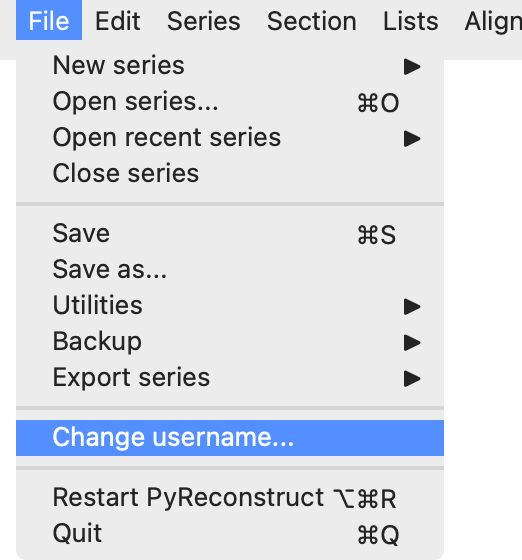{ width="261" }
  <figcaption>File > Change username...</figcaption>
</figure>

<figure class="class-fig" markdown="span">
  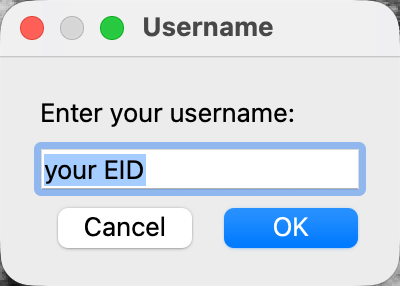{ width="200" }
  <figcaption>Enter your UT EID.</figcaption>
</figure>

In the menu bar of the main window, go to **File > Open**. Navigate to and select the "ZGBJY-[studentEID].jser" file. Be sure you have renamed your .jser with your EID.

Upon opening the .jser file, PyReconstruct will ask if you would like to locate the images. Click **Yes** and select the folder named "ZGBJY-crop-zarr".

!!! note "PyReconstruct files"
    There are 2 types of PyReconstruct files: images and .jser. The image files are, of course, the images that you will be looking at and tracing. The .jser file contains all series and trace information.

## How to make a trace

### 1. Choose the name and color for your trace

- Right-click on a square in the trace palette to change its name / attributes.

<figure class="class-fig" markdown="span">
  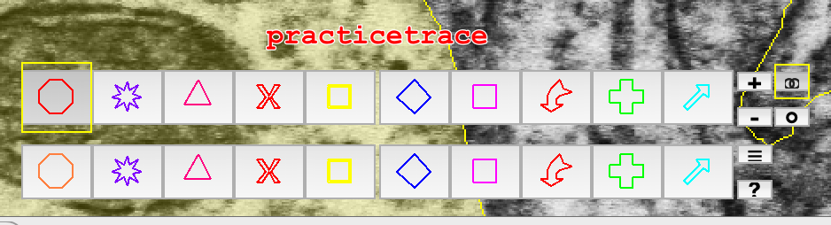{ width="469" }
  <figcaption>The trace palette, with the first square named "practicetrace".</figcaption>
</figure>

<figure class="class-fig" markdown="span">
  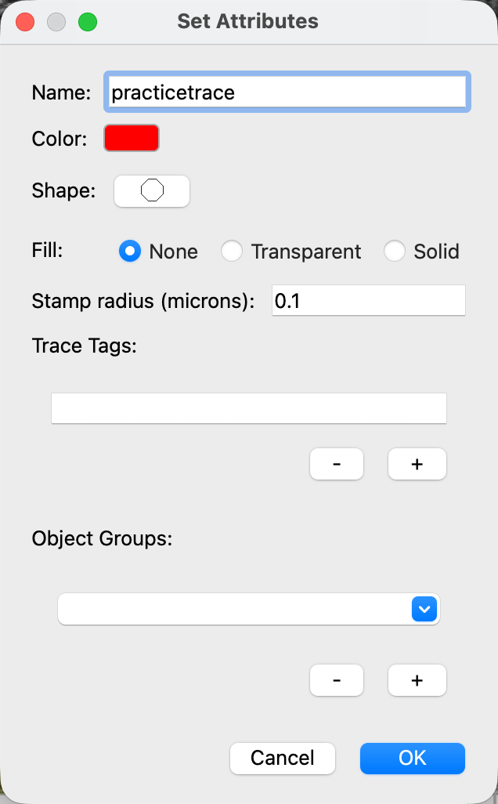{ width="318" }
  <figcaption>Set Attributes for the "practicetrace" square.</figcaption>
</figure>

<figure class="clip" markdown>

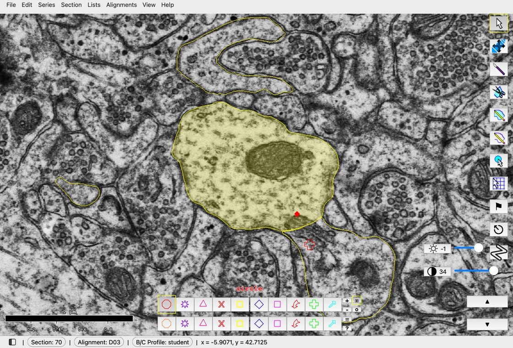

[▶ 6 s · loops](videos/guide/set-attributes.mp4){ .clip-src }

<figcaption markdown>Right-click a palette square, type a name, and click OK.</figcaption>
</figure>

### 2. Make a trace

- Choose an object to trace.
- Trace continuously: Using the closed trace pencil, hold down the left mouse-button and carefully move your mouse around, tracing the contour of the object. Release the left mouse-button when you are done tracing.
- Trace point by point: Alternatively, using the same tool, click the left mouse-button (rather than holding it down) and click repeatedly to trace an object point by point. Right-click when you are done tracing.
- You can draw circles and other closed shapes with the top tool (closed trace) and lines and other open shapes with the bottom tool (open trace). With both of them, you can hold down the left mouse button to draw continuously or click first to draw point by point.

<figure class="class-fig" markdown="span">
  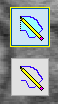
  <figcaption>Closed trace (top) and open trace (bottom).</figcaption>
</figure>

<figure class="clip" markdown>

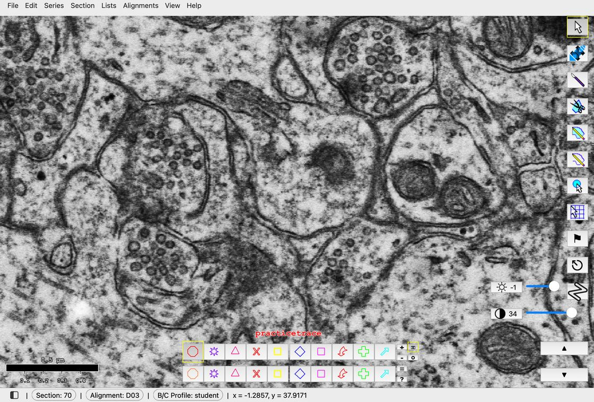

[▶ 7 s · loops](videos/guide/closed-trace.mp4){ .clip-src }

<figcaption markdown>Hold the left button, drag around the object, and let go.</figcaption>
</figure>

### How to move the image

While tracing, you will need to move the image or zoom in and out. In the Tools Window, click on Pan/Zoom:

<figure class="class-fig" markdown="span">
  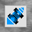
  <figcaption>Pan/Zoom.</figcaption>
</figure>

By holding down the left button and moving the mouse around, you can move the image left, right, up, and down. By holding down the right button and moving the mouse toward or away from you, you can zoom the image in and out.

## How to make a 3D reconstruction

### 1. Make traces in more sections

- Scroll up/down or hit "Page Up" / "Page Down" on the keyboard to go to other sections, or click on the paging tool in PyReconstruct:

<figure class="class-fig" markdown="span">
  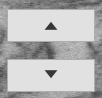
  <figcaption>The paging tool.</figcaption>
</figure>

- Trace the same object that you just traced, with the same name, e.g., "practicetrace."
- Scroll to the next section and trace your object again.
- You can do this for a few more sections if you want. You need to trace an object on a minimum of two sections in order to reconstruct it in 3D.

!!! note
    All traces with the same name are grouped together as one object.

### 2. Make a 3D reconstruction

- In the drop-down menus, select **Lists > Object List** to open the Object List window.
- In the Object List, find your trace named "practicetrace". You might need to scroll down to find it in the alphabetical list.
- Click on "practicetrace" to highlight it > right-click > **3D > Add to scene**.

## Trace palette

From the trace palette, you can select the color, name, and shape of the trace you want to make. Here's the Trace Palette:

<figure class="class-fig" markdown="span">
  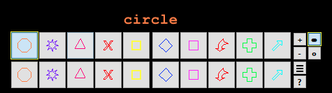
  <figcaption>The trace palette.</figcaption>
</figure>

For each one of these squares, you can change the trace (name, color, shape, fill, stamp radius, trace tags, and the object groups a new object joins) by right-clicking on the square. So you can set up your palette in advance and click on what palette square you need for each type of trace you are making.

<figure class="class-fig" markdown="span">
  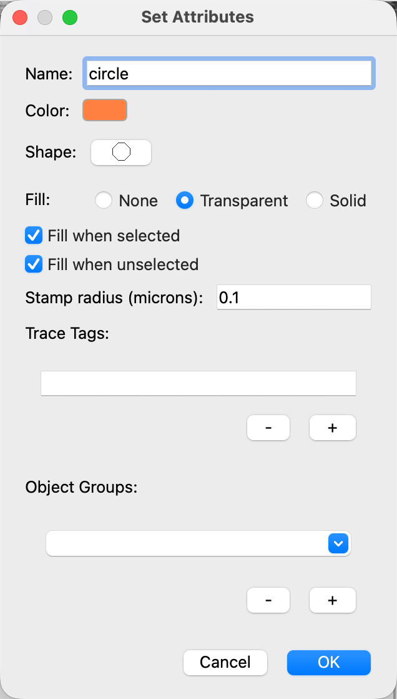{ width="318" }
  <figcaption>Set Attributes for a palette square.</figcaption>
</figure>

### Choose the name and color for your palette square

- Right-click on a palette square. Selecting that palette square will allow you to name it or change its attributes.
- Name: type in a name for your trace.
- Color: Click the colored square > pick the desired color > OK.
    - Follow this step only if you want your trace to be filled with color:
        1. Fill: select "Transparent" or "Solid" depending on how opaque you want your color fill.
        2. Check "Fill when selected" or "Fill when unselected" as desired.
- Shape: click here to change the shape of the stamp.
- Stamp radius: choose the size of the stamp in microns.

!!! tip
    You can click and drag the Trace Palette to the desired location in the window.

## Tools window

In the Tools Window, you can select a variety of tools for tracing, viewing, and measuring. Here's the Tools Window:

<figure class="class-fig" markdown="span">
  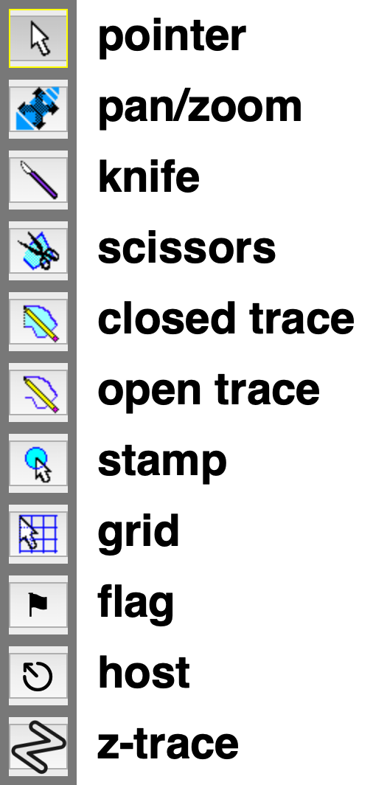{ width="253" }
  <figcaption>The Tools Window.</figcaption>
</figure>

There are a few more tools that you won't need to use in this class. Here are the ones to focus on:

| Name | What it does and how to use it |
| --- | --- |
| Pointer | This pointer tool allows you to select and deselect traces. Select: left-click on or nearby the trace. De-select: again, left-click on or near the selected trace. Ctrl-A: Select all traces. Ctrl-D: Deselect all traces. |
| Pan / Zoom | This allows you to move the image and zoom. Hold down the left button and move the mouse around to move the image. Hold down the right button and move the mouse toward or away from you to zoom the image in and out. |
| Knife | This allows you to cut a trace into pieces. The trace must be selected before being cut. You can select more than one trace, but they must all belong to the same object. |
| Scissors | This allows you to change part of a trace. Click the trace where you want to start the change. Press Backspace to remove points back along the trace, trace the new edge, then right-click to finish. |
| Closed Trace | Tracing tool. This tool will automatically connect the ends of the trace: this tool makes a closed trace.  Continuous trace: Hold down left mouse button to trace continuously, and release to end the trace.  Point-by-point trace: Click once to begin tracing point by point. Left-click to add additional points, and right-click to end the trace. |
| Open Trace | Tracing tool. This tool will not automatically connect the ends of the trace: this tool makes an open trace.  Continuous trace: Hold down left mouse button to trace continuously, and release button to end the trace.  Point-by-point trace: Click once to begin tracing point by point. Left-click to begin the trace, left-click to add additional points, and right-click to end the trace.  This tool can draw a straight line. Left-click to begin the line, left-click again at the end point, then right-click to finish it. It can also be used to measure length: left-click to start a line without ending it, and the length is listed in the bottom left of the main screen in the Status Bar, next to Line distance. |
| Stamp | This will stamp a shape trace. Select the desired shape on the Trace Palette, then right-click to set an appropriate stamp radius. Left-click to place a stamp. Left-click and drag to create a stamp of desired size. |

!!! tip
    You can click and drag the Tools Window to the desired location in the window.

## How to use the keyboard

Some of the most important hotkey commands. On a Mac, use Cmd wherever this guide says Ctrl.

- **? (Shift + /):** List the hotkey commands.
- **Delete/Backspace:** Delete selected traces.
- **Page Up:** Make next (higher) section in series the displayed section.
- **Page Down:** Make preceding (lower) section the displayed section.
- **Space Bar:** Blend the current section with the last section viewed. Useful when comparing two sections.
- **/:** Switch back & forth between the current section and last section you were looking at. Hold **/** to flicker. Useful when comparing two sections or trying to imagine the sections in 3D.
- **Ctrl-A:** Select all traces on a section.
- **Ctrl-Shift-V:** Paste attributes of copied traces onto selected traces (i.e., select a trace, hit Ctrl-C to copy its attributes, de-select, then select a second trace, hit Ctrl-Shift-V to paste the attributes of the first trace onto the second. That will change its name, color, etc).
- **Ctrl-C:** Copy the selected traces.
- **Ctrl-D:** Deselect all traces on section.
- **Ctrl-E:** Edit the attributes of a selected trace.
- **Ctrl-F:** Find trace in series. (Or, go to Lists > Object List [Ctrl+Shift+O], select the object > Find > Go to first contour or Go to last contour.)
- **Shift-G:** Copy attributes from selected trace onto selected palette square.
- **Shift-H:** Hide the selected traces. (Note: All traces in the series can be hidden at once: Series > Hide > Hide all traces.)
- **H:** Toggle to temporarily hide all traces. Red outline around the screen indicates that all traces are hidden, even if you switch between sections. (However, traces will be visible again when H is toggled off.)
- **A:** Toggle to temporarily show all traces. Green outline around the screen indicates that all traces are visible, even if you switch between sections. (However, hidden traces will go back to being hidden when A is toggled off.)
- **Shift-M:** Merge the selected traces. (This will combine two traces into one, as long as they are closed traces, have some overlap, have the same name, and are selected.)
- **Ctrl-O:** Open a series file.
- **Ctrl-Shift-O:** Open the Object List.
- **Ctrl-S:** Save.
- **Ctrl-U:** Unhide all hidden traces on that section. (Note: All hidden traces in the series can be unhidden at once: Series > Hide > Unhide all traces.)
- **Ctrl-V:** Paste traces into section.
- **Ctrl-X:** Cut selected traces from section for later pasting.
- **Ctrl-Y:** Re-do.
- **Ctrl-Z:** Undo.
- **Backspace:** Delete last trace point entered when making a trace or using the scissors.
- **Ctrl-0, ..., Ctrl-9; Shift-Ctrl-0, ..., Shift-Ctrl-9:** Open attributes for the trace palette squares.

## How to use the mouse

Left-click to select and deselect traces. (You must click pretty close to the trace, but it doesn't have to be precisely on the trace.)

Right-click on a selected trace and choose **Trace > Edit attributes...** to edit its attributes (or press Ctrl-E).

In the Tools Window, make sure you are familiar with Pan / Zoom, which allows you to move the image and zoom. After selecting the Pan and Zoom tool, hold down the left button and move the mouse around to move the image. Hold down the right button and move the mouse toward or away from you to zoom the image in and out.

## Status bar

The bottom left of the main screen is known as the Status Bar:

<figure class="class-fig" markdown="span">
  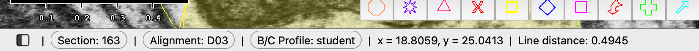{ width="826" }
  <figcaption>The Status Bar while drawing an open trace.</figcaption>
</figure>

The Status Bar indicates, from left to right:

- Section: current section number, i.e., the section you are viewing.
- Alignment: Which alignment the series is in (used when there are multiple alignments available for a series).
- B/C Profile: which brightness/contrast profile is in use. You can click Section, Alignment, or B/C Profile to change it.
- Position: the x-y coordinates of the cursor position.
- Closest trace: name of the trace closest to the cursor.
- Line distance: when drawing a line with the open trace, length will display here.

## Object List

To open the Object List, go to **Lists > Object list** (Ctrl+Shift+O).

You can filter the object list: go to **Filter > Regex filter...**

<figure class="class-fig" markdown="span">
  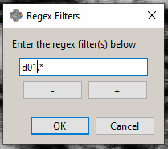
  <figcaption>Regex filter.</figcaption>
</figure>

This uses regular expressions to filter what is listed in the object list. Replace the .\* in the box with "d01.\*" to see all traces starting with d01. A period (.) stands for any one character, and .\* stands for any run of characters. "#" stands for one digit, and "#+" stands for a whole number.

To choose which columns are listed, use **Columns > Set columns...** in the Object List:

<figure class="class-fig" markdown="span">
  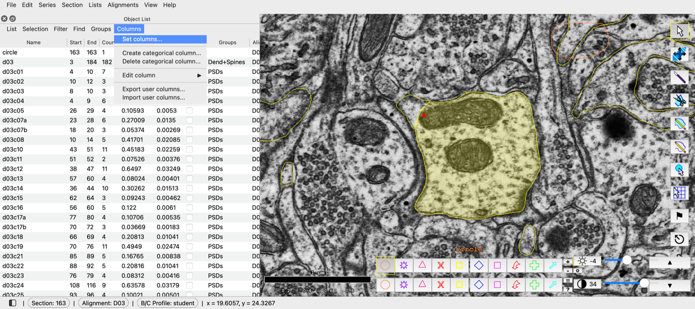
  <figcaption>Columns > Set columns... in the Object List.</figcaption>
</figure>

There are numerous column options to become familiar with, based on what you would like to see in your objects list.

## 3D object viewer

In the Object List, you can add or remove objects from the 3D Object Viewer and change their attributes by right-clicking on the object name. You can add an object to the 3D Object Viewer by right-clicking the object > **3D > Add to scene**.

<figure class="class-fig" markdown="span">
  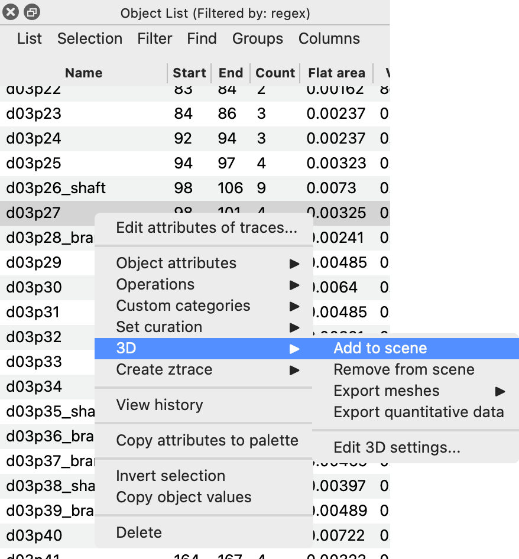{ width="439" }
  <figcaption>Right-click > 3D > Add to scene.</figcaption>
</figure>

<figure class="clip" markdown>

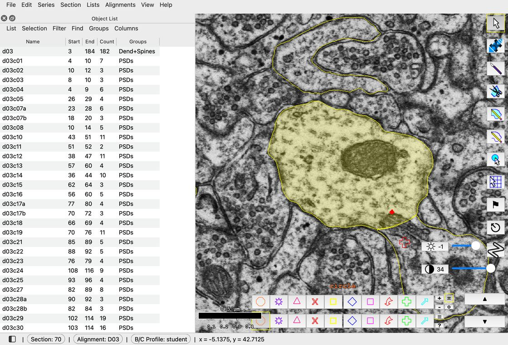

[▶ 8 s · loops](videos/guide/add-to-scene.mp4){ .clip-src }

<figcaption markdown>Right-click > 3D > Add to scene, then drag in the 3D window to turn the view.</figcaption>
</figure>

Zoom in and out by using the scroll wheel on your mouse. Hold the left button and move the mouse to spin the view. (To rotate around a different object, click it to select it and press F, or use Scene > View > Center on selected.)

In the 3D scene, put your cursor over the object to see the name of the object and the section number. Double-click the object to be taken directly to that object in the 2D image. This is very useful for finding errors in the 3D and directly going to the trace that needs to be fixed.

To change how the object is displayed in 3D, right-click an object in the Object List > **3D > Edit 3D settings...**:

<figure class="class-fig" markdown="span">
  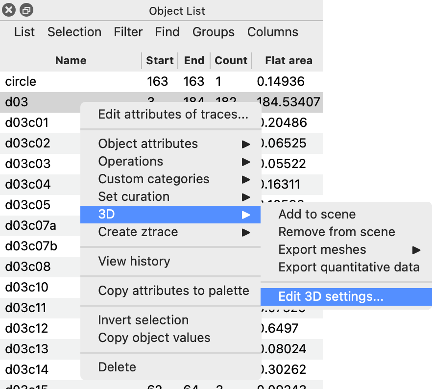{ width="441" }
  <figcaption>Right-click > 3D > Edit 3D settings...</figcaption>
</figure>

Here you can select 3D type (surface, spheres, or contours) and opacity (with 1 being opaque and .1 transparent):

<figure class="class-fig" markdown="span">
  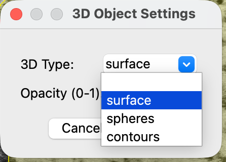{ width="223" }
  <figcaption>3D Object Settings.</figcaption>
</figure>

Opacity changes right away. To see a new 3D type, use **Scene > Reload selected** in the 3D window.

Be familiar with the menu options in the 3D viewer: File, Edit, Scene, Scale Cube, Help. Here you can add a scale cube to your scene and more.

<figure class="class-fig" markdown="span">
  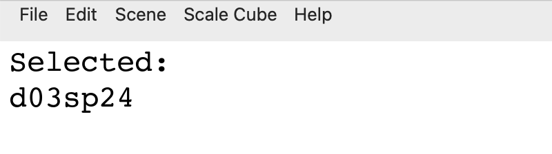{ width="400" }
  <figcaption>The 3D window menu bar.</figcaption>
</figure>

Scale cube of desired size can be added. Select the scale cube (and only the scale cube; ensure other objects are not selected) and hit Ctrl-E to change attributes:

<figure class="class-fig" markdown="span">
  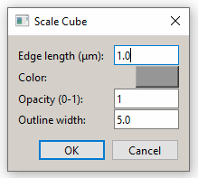{ width="244" }
  <figcaption>Scale cube attributes.</figcaption>
</figure>

Move it in x with the left and right arrows, in y with the up and down arrows, and in z with Ctrl-Up and Ctrl-Down.

## Moving traces

Selected traces can be moved around with the arrow keys; hold Ctrl for small steps or Shift for large steps. Make sure a trace is selected first. You can also click and manually drag a selected trace to the desired location.

## Saving

PyReconstruct will prompt you to save on exit. You can hit Ctrl-S (Save) periodically while working to ensure that your work is saved.
